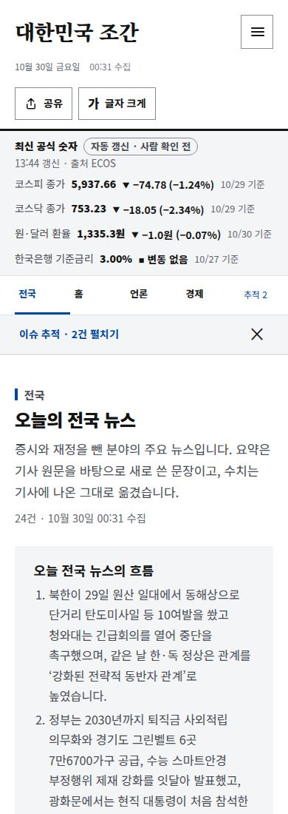
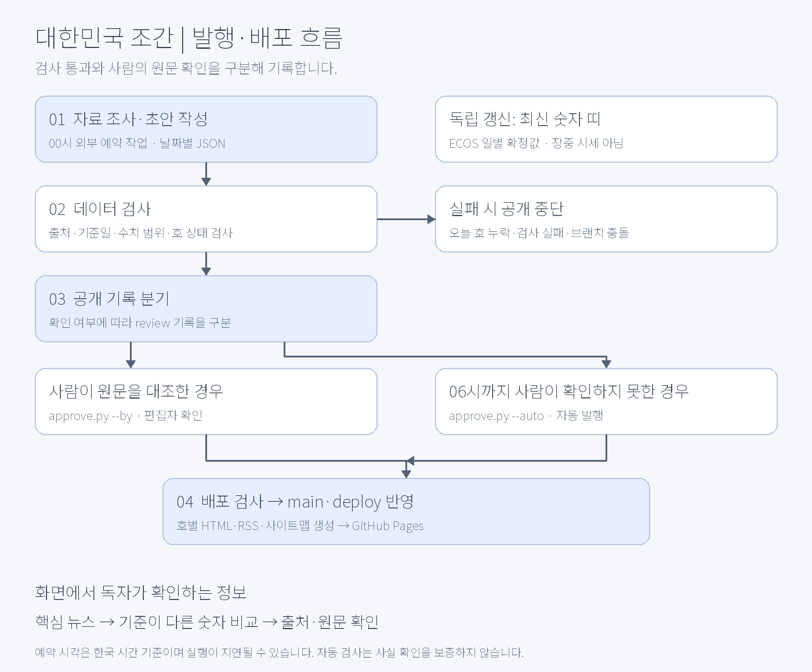

# 대한민국 조간

**기사마다 다르게 보도되는 숫자를 출처와 기준으로 비교하는 데이터 신문입니다.** 전국·17개 시도 뉴스와 경제·산업·재정 지표를 하루 한 호로 정리합니다.

[서비스 보기](https://korea-jogan.com/) · [기획 배경](docs/planning/01-product.md) · [기술 설계](docs/dev/architecture.md) · [디자인 시스템](design/guide.md)

## 화면과 서비스 흐름

<table>
<tr><th>PC · 전국 뉴스부터 읽는 신문형 지면</th><th>모바일 · 세로 읽기와 상단 탐색</th></tr>
<tr><td></td><td></td></tr>
</table>

*2026.10.30 운영 사이트를 캡처했습니다. 기사·통계와 추적 상태는 촬영 시점 기준입니다.*

독자는 **전국 뉴스에서 오늘의 흐름을 읽고, 이슈 추적에서 진행 상황과 남은 확인 사항을 살핀 뒤** 주요 뉴스·수치 비교·원문으로 이동합니다. 전국 → 이슈 추적 → 홈(주요 뉴스) → 지역 → 언론 → 정치 → 경제 → 산업 → 재정의 9개 섹션이며, 지역은 17개 시도를 6개 권역으로 묶었습니다.

| 읽는 순서 | 화면에서 제공하는 정보 | 설계한 이유 |
| --- | --- | --- |
| 1면 · 전국 | 분야별 기사와 오늘의 흐름 | 경제 지표 밖의 주요 소식도 먼저 탐색 |
| 2면 · 이슈 추적 | 진행 단계·타임라인·관련 기사 표·다음 확인 사항 | 결론이 나기 전까지 같은 사안을 이어서 확인 |
| 주요 뉴스·비교 | 대표 뉴스, 핵심 숫자 4개, 기준이 다른 숫자 | 값뿐 아니라 비교 시점·집계 조건을 함께 읽기 |
| 분야·근거 탐색 | 지역·언론·정치·경제·산업·재정, 출처 링크 | 요약에서 원자료로 이어지는 경로 제공 |


상단 추적 막대는 펼치거나 현재 세션에서 숨길 수 있습니다. `추적 2` 버튼으로 다시 열고, 닫으면 읽던 위치와 포커스로 돌아옵니다. 지난 호에는 현재 추적 상태를 붙이지 않습니다. [최신 변경·검증 기록](docs/dev/changes-2026-10-30.md) · [Figma 시안](https://www.figma.com/design/Eep2qLjiPT9jhDUyLU8Zjx)

## 자료가 화면에 나오기까지



00시 조사는 **외부 예약 작업**, 06시 공개는 **GitHub Actions**가 담당합니다. 사람이 원문을 대조한 호에는 편집자 확인을, 그렇지 않은 호에는 자동 발행을 표시합니다. 두 경로 모두 검사를 통과해야 공개되며, 검사 실패·오늘 호 누락·브랜치 충돌 시 공개를 중단합니다. ECOS 최신 숫자 띠는 승인된 조간 본문과 별도로 갱신합니다.

[발행 운영 절차](docs/planning/runbook.md) · [배포 구조](docs/dev/architecture.md) · [구직용 프로젝트 정리](https://www.notion.so/3ffcbbdd109b8167a28dd65769e55676)

## 프로젝트 소개

같은 사건을 다룬 기사에서도 집계 기간이나 비교 시점에 따라 숫자가 달라집니다. 숫자만 요약하면 이 차이가 사라져, 독자가 원문을 다시 찾아야 합니다. 대한민국 조간은 **값과 함께 출처·기준일·집계 조건을 보여 주는 것**에서 출발했습니다.

1인 프로젝트로 서비스 기획, 정보 구조, 디자인 시스템, 화면 구현, 데이터 규격, 검사와 배포 흐름을 구성했습니다. AI는 자료 조사와 초안 작성에 활용하고, 사람이 확인한 호와 자동으로 공개된 호를 데이터와 화면에서 구분합니다.

| 항목 | 내용 |
| --- | --- |
| 형태 | 비영리 데이터 신문, 하루 한 호 발행 |
| 주요 화면 | 전국·이슈 추적·홈·지역·언론·정치·경제·산업·재정, 총 9개 섹션 |
| 화면 기술 | HTML, CSS, 바닐라 JavaScript. 프레임워크·번들러 없이 실행 |
| 데이터·자동화 | 날짜별 JSON, Python 수집·검증·생성 스크립트 |
| 배포 | GitHub Actions, GitHub Pages, `dev`·`main`·`deploy` 브랜치 분리 |
| 디자인 | JSON 토큰에서 CSS 변수 생성, 밝은·어두운 테마, 공통 컴포넌트 |
| 측정 | GA4 측정 ID 연결, 출처 확인·숫자 비교·검색 등 행동 이벤트 구현 |

## 담당 역할

1인 프로젝트에서 역할별 판단과 산출물을 나눠 진행했습니다. 기획 의도를 데이터 규격·화면·운영 절차까지 연결하는 데 집중했습니다.

| 역할 | 직접 결정하고 구현한 내용 | 확인할 산출물 |
| --- | --- | --- |
| 서비스 기획·PM | 문제 정의, 섹션 구성, 발행 원칙과 우선순위 | [서비스 기획](docs/planning/01-product.md) |
| UX/UI·퍼블리싱 | 정보 밀도, 반응형 탐색, 테마·타이포그래피·디자인 토큰 | [디자인 가이드](design/guide.md) |
| 프론트엔드 | JSON 렌더링, 공통 메뉴, 출처·수치 비교 UI, 행동 이벤트 | [화면 소스](dev/web/src/) |
| 데이터·운영 | 수집·검증 스크립트, 확인 상태, 정정·배포 절차 | [운영 런북](docs/planning/runbook.md) |

## 직접 설계한 부분

### 숫자를 보여 주는 데서 출처를 확인하는 흐름까지

핵심 숫자에 기관명·원문 링크·발표일·기준일을 붙였습니다. 같은 주제에서 기준이 다른 수치는 비교 표로 분리하고, 홈에서도 바로 열 수 있게 했습니다. 출처를 확인하는 행동이 서비스의 핵심이라고 보고 `src-open`, `split-open`, `split-home` 이벤트를 마련했습니다.

[출처 UI](dev/web/src/core/ui.js) · [언론 비교](dev/web/src/components/media/media.js) · [홈 비교 카드](dev/web/src/components/splits/splits.js)

### 많은 정보를 모바일에서도 읽을 수 있게

17개 시도를 6개 권역으로 묶고, 긴 목록은 3건씩 먼저 보여 줍니다. PC·모바일 모두 상단 분야 메뉴와 전체 메뉴를 사용하며, 하단 탐색은 문서 흐름 안에 둡니다. 모바일 제호·발행 상태·도구 버튼을 줄로 나누고, 큰 글자에서도 가로 넘침이 생기지 않도록 구성했습니다. 전체 메뉴와 추적 패널은 Esc 닫기와 포커스 복귀를 제공하며, PC·모바일 모두 맨 위로 버튼을 사용합니다.

[공통 메뉴 설정](dev/web/src/core/config.js) · [탐색과 서랍](dev/web/src/components/nav/nav.js) · [지역 선택](dev/web/src/components/regions/regions.js)

### 사건의 진행 상황을 완료율로 과장하지 않기

선관위 특검과 무안공항 참사는 단계·근거 기사·다음 확인 사항으로 추적합니다. 무안공항 기사 4건에는 보도일·매체·원문·요약·확인 범위를 연결했습니다. 보도에 따른 편집상 단계이며 공식 해결률은 아닙니다. 최종 발표일이 미확정이면 기간 백분율을 표시하지 않고, 송치와 유죄 확정·수색 예정과 완료를 구분합니다.

[추적 화면](dev/web/src/components/track/track.js) · [데이터 규격](docs/planning/data-spec.md#trackersjson) · [무안공항 근거 기록](docs/research/muan-airport-20261030.md)

### 디자인 기준을 코드로 관리

색·글자·간격·모서리 등의 원본을 `design/tokens.json`에 모았습니다. Python으로 CSS 변수를 생성하고, CI에서 원본과 생성 파일의 일치 여부를 검사합니다. 상승·하락은 기호와 글자로, 결산·전망은 선과 배지 형태로 구분했습니다.

[디자인 토큰](design/tokens.json) · [토큰 생성기](dev/pipeline/build/build_tokens.py) · [컴포넌트 스타일](dev/web/src/styles/kj.css)

### 반복 발행과 오류 대응을 함께 설계

00시 조사 작업이 초안을 만들고, 06시 워크플로가 검사를 통과한 호를 공개합니다. 사람의 원문 대조 여부는 `review`에 별도로 기록합니다. 필수 데이터·출처 링크·수치 범위·호 상태를 검사하고, 오류를 수정할 때는 변경 전후 값과 이유를 정정 기록에 남깁니다.

검사 통과는 데이터 형식과 일부 운영 조건을 만족했다는 뜻입니다. 원문의 정확성까지 자동으로 보증하지 않으므로, 본문 열람 여부와 수집 한계도 공개합니다.

[검증](dev/pipeline/publish/validate.py) · [공개 상태 전환](dev/pipeline/publish/approve.py) · [일일 운영 절차](docs/planning/runbook.md)

### 정적 사이트의 검색 노출 보완

브라우저에서 JSON을 읽는 화면만으로는 검색 로봇이 내용을 놓칠 수 있습니다. 배포 시 호별 HTML에 제목·설명·대표 주소·본문 요약·구조화 데이터를 미리 생성하도록 구성했습니다. RSS와 사이트맵도 같은 발행 목록에서 만들고, 새 주소는 IndexNow로 알립니다.

[호별 페이지 생성](dev/pipeline/build/build_pages.py) · [RSS·사이트맵](dev/pipeline/build/build_feed.py) · [IndexNow](dev/pipeline/publish/indexnow.py)

## 최신 반영 · 2026.10.30

- 신문형 지면과 모바일 세로 배치, 관련 주제·핵심 지표 요약을 적용했습니다.
- 이슈 추적 패널, 무안공항 기사 표, 기한 미확정 데이터 검사를 추가했습니다.
- 전국 뉴스 1면·이슈 추적 2면 순서를 반영하고, 버튼 선택 대비·기간 패널 여백·PC 맨 위로 동작을 수정했습니다.
- 직전 배포는 Python 52건·공개 지면 브라우저 39건·관리자 20건, 데이터·토큰 검사를 통과했습니다. 운영 사이트의 320·390·1440px에서 지면 순서·버튼 대비·패널 여백·맨 위로 이동을 확인했습니다. 이는 기능 검증 기록이며 이용자 성과가 아닙니다.

[디자인·추적 배포 PR #68](https://github.com/MinsangKwak/korea-jogan/pull/68) · [지면·도구 개선 PR #70](https://github.com/MinsangKwak/korea-jogan/pull/70) · [상세 변경 기록](docs/dev/changes-2026-10-30.md)

## 변경 이력에서 볼 수 있는 설계 과정

| 변화 | 판단과 구현 | 관련 커밋 |
| --- | --- | --- |
| 신뢰 정보 보강 | 승인 기록·정정·미발행 안내를 추가해 데이터 상태를 드러냈습니다 | [88a700a](https://github.com/MinsangKwak/korea-jogan/commit/88a700a) · [4c9af47](https://github.com/MinsangKwak/korea-jogan/commit/4c9af47) |
| 화면 기준 통합 | 디자인 토큰 생성과 공통 스타일을 도입했습니다 | [8fc4304](https://github.com/MinsangKwak/korea-jogan/commit/8fc4304) · [5d4dbcc](https://github.com/MinsangKwak/korea-jogan/commit/5d4dbcc) |
| 읽기 흐름 개선 | 권역별 지역 선택과 목록 접기로 정보 밀도를 조정했습니다 | [4affa10](https://github.com/MinsangKwak/korea-jogan/commit/4affa10) · [80255a0](https://github.com/MinsangKwak/korea-jogan/commit/80255a0) |
| 발행 정책 변경 | 사람 확인을 기다리던 흐름에 06시 자동 공개를 추가하고 확인 여부를 구분했습니다 | [af8c746](https://github.com/MinsangKwak/korea-jogan/commit/af8c746) |
| 검색과 유지보수 보완 | 호별 검색 페이지를 만들고, 소스·디자인·문서의 위치를 정리했습니다 | [f8592fe](https://github.com/MinsangKwak/korea-jogan/commit/f8592fe) · [f8e5401](https://github.com/MinsangKwak/korea-jogan/commit/f8e5401) · [4d1cc37](https://github.com/MinsangKwak/korea-jogan/commit/4d1cc37) |

위 내용은 구현 범위와 의사결정의 기록입니다. 사용자 증가나 읽기 시간 단축 등의 성과는 측정 결과가 확보되기 전까지 제시하지 않습니다.

## 실행과 확인

저장소 루트에서 실행합니다. 화면이 JSON을 `fetch`하므로 HTML 파일을 직접 열지 않고 HTTP 서버를 사용합니다. CI 기준은 Python 3.12, Node.js 22입니다.

```bash
python3 -m http.server -d dev/web 8000
```

브라우저에서 `http://localhost:8000`을 엽니다. 검사는 아래 명령으로 실행합니다.

```bash
python3 dev/pipeline/publish/validate.py
python3 dev/pipeline/build/build_tokens.py --check
python3 -m unittest discover -s dev/tests
git config core.hooksPath dev/tools/githooks
```

화면 검증은 `dev/tests/browser`에서 `npm ci`, `npx playwright install chromium`, `npm test` 순서로 실행합니다. 최신·지난 호와 로딩·오류 화면, 모바일 가로 넘침을 실제 Chromium에서 검사합니다.

[2026-10-23 운영 확인·안정화 기록](docs/dev/operations-2026-10-23.md)

운영 화면은 [`/admin/`](https://korea-jogan.com/admin/)에서 제공합니다. Google OAuth 연결 후 오늘·최근 7일 방문자와 섹션별 체류 시간, 기간별 이용 흐름을 조회하며, 공개 발행 현황도 함께 확인합니다. 최초 사용에는 웹 앱용 OAuth 클라이언트 ID 설정이 필요합니다. [연결 절차와 검증 범위](docs/dev/ga4-admin.md)

## 저장소 안내

| 경로 | 역할 |
| --- | --- |
| [dev/web/](dev/web/) | 실제 배포하는 화면, 섹션별 JS·CSS, 발행 JSON |
| [dev/pipeline/](dev/pipeline/) | 자료 수집, 데이터 검사, 배포 파일 생성 |
| [dev/tests/](dev/tests/) | 데이터·생성 스크립트, 공개 지면·관리자 브라우저 회귀 검사 |
| [design/](design/) | 디자인 가이드, 토큰 원본, 공유 이미지 원본 |
| [docs/planning/](docs/planning/) | 서비스 기획, 데이터 규격, 발행 절차 |
| [docs/dev/](docs/dev/) | 기술 설계, 브랜치·커밋 규칙, AI 작업 지침 |
| [.github/](.github/) | 검사·발행·배포 워크플로와 오류 신고 양식 |

일반 변경은 `dev`에서 검증해 `main`으로 병합합니다. 웹 배포는 `deploy`를 통해 별도로 진행합니다. [브랜치 운영 규칙](docs/dev/branches.md)과 [커밋 규칙](docs/dev/commits.md)에 상세 절차가 있습니다.

## 현재 한계와 다음 과제

- 조간 본문은 공식 발표와 기사를 조사해 작성합니다. ECOS 수집기는 구현돼 있지만, 모든 지표가 API로 연결된 상태는 아닙니다. KOSIS·관세청·국회 수집은 후속 과제입니다.
- 최신 숫자 띠는 ECOS의 일별 확정값이며 장중 시세가 아닙니다. 승인된 조간과 별개로 갱신하고 사람 확인 전임을 표시합니다.
- RSS 피드 설정은 26곳입니다. 피드 상태에 따라 실제 수집 범위가 달라지며, 본문을 읽지 못한 기사는 그 사실을 데이터에 남깁니다.
- GA4 측정 코드는 연결돼 있습니다. GoatCounter 주소는 비어 있습니다. 수집 결과를 검토해 핵심 독자 가설과 섹션 우선순위를 검증할 예정입니다.
- 출처 링크의 존재와 형식 검사는 원문의 사실 확인을 대신하지 않습니다. 자동 발행 이후에도 정정 절차가 필요합니다.

API 키는 GitHub Secrets에서 관리합니다. 현재 ECOS는 `ECOS_API_KEY`를 사용하며, 후속 API 키는 해당 수집기를 도입할 때 설정합니다.

## 이용 조건

코드는 [MIT](LICENSE), 서비스에서 직접 작성한 글은 CC BY 4.0을 적용합니다. 기사와 통계 등 원자료는 각 권리자·기관의 이용 조건을 따릅니다.
