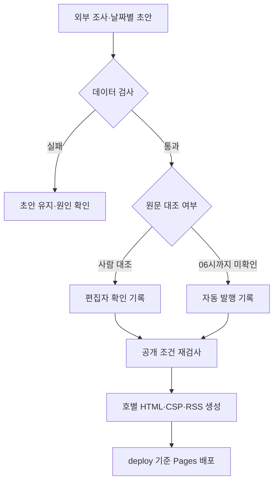

# 기술 구조와 설계 판단

**정적 화면과 날짜별 JSON을 중심으로, 수집·검사·페이지 생성을 배포 전 작업으로 분리했습니다.** 상시 애플리케이션 서버와 DB를 운영하지 않으면서 발행 단위·확인 상태·변경 이력을 남기는 구조입니다.

2026.11.03 기능 기준입니다. [최신 변경·검증](changes-2026-11-03-sections.md) · [문서 안내](../README.md) · [데이터 규격](../planning/data-spec.md)

## 전체 구조

| 영역 | 위치 | 책임 |
| --- | --- | --- |
| 정적 지면 | [dev/web/](../../dev/web/) | HTML·CSS·바닐라 JavaScript, 원본 발행 데이터 |
| 공통 로직 | [src/core/](../../dev/web/src/core/) | 데이터·서식·출처 UI·반응형 펼침·테마·측정·주소 |
| 섹션 렌더링 | [src/components/](../../dev/web/src/components/) | 헤더·탐색·전국·추적·언론·지역·정치·경제·산업·재정 |
| 날짜별 발행 | [data/issues/](../../dev/web/data/issues/) | 호별 JSON과 최신 호 색인 |
| 별도 운영 데이터 | [data/](../../dev/web/data/) | 장기 추적·정정·수집 설정·최신 숫자 |
| 수집 | [pipeline/collect/](../../dev/pipeline/collect/) | RSS 목록과 ECOS 원자료 수집·변환 |
| 검사·공개 | [pipeline/publish/](../../dev/pipeline/publish/) | 형식·공개 조건 검사, 확인 기록, IndexNow 알림 |
| 생성 | [pipeline/build/](../../dev/pipeline/build/) | 토큰 CSS·호별 HTML·CSP·RSS·사이트맵·최신 숫자 |
| 자동 검사 | [dev/tests/](../../dev/tests/) | Python과 공개 지면·관리자·CSP Chromium 검사 |

화면은 프레임워크·번들러 없이 실행합니다. 경제 슬라이드용 Swiper는 버전·라이선스·원본 해시를 기록해 [로컬 vendor](../../dev/web/assets/vendor/swiper/README.md)에 보관합니다. 이 선택은 빌드 환경을 줄이는 대신 스크립트 순서·전역 이름·의존성 갱신을 직접 관리해야 하는 비용이 있습니다.

## 발행과 배포 흐름

운영 규약상 00시 조사는 외부 예약 작업이 담당합니다. 저장소의 `daily.yml`은 수집기를 수동으로 실행하며, 외부 조사 예약까지 재현하지는 않습니다. `publish.yml`은 06시 공개를 목표로 06:07에 실행하고 06:37·07:17·08:17에 재확인합니다. 예약 시각과 실제 실행 시각은 다를 수 있습니다.

사람 확인과 자동 발행은 모두 `published`이며 `review.auto`로 구분합니다. `draft`는 배포 검사에서 차단하고 `prototype` 시안은 허용합니다. 확인자·시각을 임의로 만들어 사람 대조를 마친 것으로 표시하지 않습니다. [발행·정정·복구 절차](../planning/runbook.md)

## 브라우저의 로딩과 오류 경계

배포 HTML에는 공개된 호의 `issue-data`와 `issue-index`를 넣습니다. 브라우저는 내장 데이터를 우선 사용하고, 없으면 색인과 날짜별 JSON을 요청합니다. 저장소 색인에는 공개 전 초안이 포함될 수 있어 생성 페이지의 공개 목록과 구분합니다.

[main.js](../../dev/web/src/main.js)는 필수 초기화와 섹션 렌더링을 같은 `try/catch`에서 처리합니다. 모두 성공한 뒤에 정적 검색 요약을 제거하고 `ready`로 전환합니다. 실패하면 요약을 남기고 재시도 화면을 표시합니다. 보조 데이터는 본문 준비 뒤에 별도로 읽습니다.

| 데이터·자원 | 실패하거나 늦게 준비될 때 |
| --- | --- |
| 호 본문 | 네트워크 요청 12초 제한, 요약 보존·오류·재시도 |
| 메인 스크립트 | 초기 20초 타이머가 지연 안내·정적 요약·재시도를 남김 |
| 추적 데이터 | 해당 영역을 숨기며 일일 본문의 성공은 유지 |
| 정정 데이터 | 정정 영역에 다시 확인할 안내 표시 |
| 최신 숫자 | 파일을 읽지 못하면 숫자 띠 숨김 |
| 외부 글꼴 | 첫 지면을 막지 않고 비동기 적용, 기본 글꼴로 읽기 가능 |
| 경제 슬라이더 | 해당 영역 800px 전에서 지연 로드, 실패·늦은 읽기 전환 시 전체 격자 유지 |

구현 근거: [data.js](../../dev/web/src/core/data.js) · [main.js](../../dev/web/src/main.js) · [fonts.js](../../dev/web/src/core/fonts.js) · [경제 렌더링](../../dev/web/src/components/economy/economy.js)

## PC와 모바일에서 정보를 나누는 방법

| 구현 | 현재 동작·판단 |
| --- | --- |
| 공통 `SECTIONS` | 전국·추적·홈·지역·언론·정치·경제·산업·재정 순서를 탐색과 본문에서 공유 |
| `collapse()` | 긴 목록은 일부를 먼저 표시하고 더보기 제공. 대상 이동 시 필요한 목록을 펼침 |
| `responsiveDisclosure()` | 900px 경계로 PC 기본 펼침·모바일 기본 접힘을 적용하고 화면 폭별 사용자 선택을 기억 |
| 지역 선택 | 17개 시도를 6개 권역으로 묶고 좁은 화면 안에서 줄바꿈 |
| 머리기사 보조 목록 | 901px부터 CSS `contain:size`와 grid stretch로 왼쪽 기사 높이에 맞춰 내부 스크롤 |
| PC 비교 배치 | 1,100px부터 사안 카드 두 열, 제목 옆 검색, 산업 요약 옆 그래프 |
| 경제 순환 | 로컬 Swiper·이전/다음·좌우 키·재생 제어. 호버·포커스·숨김·화면 밖·직접 읽기에서 정지 |
| 테마·큰 글자 | 기기 설정/라이트/다크와 글자 확대. 저장이 막혀도 동작하며 관리자와 테마 공유 |
| 전체 메뉴·추적 모달 | 포커스 제한·복귀, Esc 닫기, 내부 스크롤. 닫힌 목적지로 메뉴 이동 시 먼저 펼침 |

요약·현재 단계·다음 확인·주의사항·숫자·기준일·검색은 항상 표시합니다. 긴 근거 표는 건수를 보여 주고 필요한 때 펼칩니다. 세부 분기와 간격은 [디자인 가이드](../../design/guide.md)를 따릅니다.

## 장기 추적과 날짜별 호의 구분

[trackers.json](../../dev/web/data/trackers.json)은 날짜별 조간과 별도로 읽고, 지난 호에서는 숨깁니다. 추적 막대를 숨긴 상태는 `sessionStorage`에 저장하며 저장 불가 환경도 처리합니다.

| 정보 | 해석 기준 |
| --- | --- |
| `phases`·`phaseIndex` | 보도에 따른 편집상 진행 단계이며 공식 완료율 아님 |
| `start`·`end` | 기한이 알려진 사안의 기간 경과. 해결률 아님 |
| `periodUnknown` | 최종 기한이 미확정이면 날짜·기간 백분율을 생략 |
| 기사 표 | 보도일·매체·원문·요약·확인 범위 유지 |

PC에서 카드 본문을 제한된 높이로 스크롤하고, 모바일에서는 진행 정보 뒤에 일정·근거를 펼쳐 읽습니다. 표가 있는 경우 중복된 최근 기사 목록은 표로 통합합니다. 계획과 완료, 송치와 유죄 확정을 같은 단계로 취급하지 않습니다.

## 공개 본문과 최신 숫자·관리자의 구분

날짜별 조간은 발행 당시의 기록입니다. ECOS `live.json`은 장중 시세가 아닌 최신 일별 확정 통계이며, 자동 갱신·사람 확인 전임을 표시합니다. 과거 호의 값을 덮어쓰지 않습니다.

평일 09:17~22:17 매시 예약은 같은 `deploy` 커밋에서 값을 받아 다시 배포합니다. 갱신 파일은 Git에 커밋하지 않고, 키가 없으면 예약 배포를 건너뜁니다. 수집 실패는 조간 배포를 막지 않습니다. [build_live.py](../../dev/pipeline/build/build_live.py)

`/admin/`은 공개 발행 상태와 권한이 있는 계정의 GA4 통계를 나눠 보여 줍니다. Google OAuth 토큰은 메모리에서만 사용하고 조회는 브라우저에서 Google API로 직접 보냅니다. 계정 권한·실제 지표 값은 자동 검사의 모의 응답과 다릅니다. [연결 설정·오류 대응](ga4-admin.md)

## 검색·공유와 정적 보안

[build_pages.py](../../dev/pipeline/build/build_pages.py)는 최신 호와 `/YYYY-MM-DD`에 제목·설명·대표 주소·본문 요약·구조화 데이터를 생성합니다. 기존 `?d=YYYY-MM-DD`는 존재하는 호별 주소로 옮깁니다. RSS·사이트맵 생성과 IndexNow 알림을 갖췄으며, 알림 실패는 배포 실패로 처리하지 않습니다. 검색 순위 개선을 보장하는 기능은 아닙니다.

[build_security.py](../../dev/pipeline/build/build_security.py)는 최종 HTML의 인라인 실행 코드에 SHA-256 해시를 계산해 메타 CSP를 갱신합니다. JSON 데이터는 실행 코드로 허용하지 않습니다. 공개면과 관리자면의 Google 연결 범위를 나누고, 자체 스크립트와 명시한 출처만 허용합니다.

임의 인라인 코드·이벤트 속성·eval·object·base·worker를 차단하며 referrer의 외부 경로 전달을 제한합니다. 동적 그래프 때문에 인라인 스타일은 허용합니다. GitHub Pages의 메타 방식으로 `frame-ancestors`·HSTS·`nosniff` 같은 응답 헤더를 설정한 것은 아닙니다. [적용 범위·제약](changes-2026-11-03-layout.md#정적-페이지의-보안)

데이터 문자열은 [ui.js](../../dev/web/src/core/ui.js)의 `textContent`로 삽입합니다. [tokens.json](../../design/tokens.json)에서 생성한 CSS와 원본의 일치는 CI로 확인하며, 모든 스타일의 토큰 사용이나 접근성 적합성까지 보증하지는 않습니다.

## 검사와 운영자의 확인 범위

| 검사 | 확인하는 범위 |
| --- | --- |
| 데이터·배포 규칙 | 필수값과 하위 필드·허용 상태·링크 형식·수치 범위·미확정 기간의 모순 |
| Python | 데이터·발행·생성 스크립트와 보안 정책 |
| 공개 Chromium | 최신/지난 호, 로딩·오류, 탐색·반응형·펼침·키보드·슬라이드 |
| 관리자 Chromium | 모의 인증/API 응답, 오류·만료·중복 조회·연결 해제·테마 |
| CSP Chromium | 정상 동작·허용 출처와 코드·이벤트·외부 연결 주입 차단 |

2026.11.03 기능 배포는 자동 검사 148건과 운영 사이트 검사 34건을 통과했습니다. [당시 검증 근거](changes-2026-11-03-sections.md)

형식 검사와 링크 존재는 원문의 진위·접속 가능성·계산 정확성·지역별 기사 수 충족을 보증하지 않습니다. 원문 대조와 정정은 [런북](../planning/runbook.md), 필드별 검사 범위는 [데이터 규격](../planning/data-spec.md)을 따릅니다.

## 변경 보호와 후속 과제

`dev`는 작업본, `main`은 검증본, `deploy`는 배포 기준입니다. 대상 브랜치가 반영할 커밋의 조상일 때만 빨리 감기하며, 이력이 갈라지면 멈춰 다른 변경을 덮어쓰지 않습니다. 아침 발행은 후속 배포 워크플로를 명시적으로 호출합니다. [브랜치 절차](branches.md)

| 선택 | 후속 관리가 필요한 부분 |
| --- | --- |
| 정적 파일·전역 스크립트 | 로딩 순서, 이름 충돌, 라이브러리 버전·라이선스 |
| 날짜별 JSON | 장기 누적 시 색인 분할, 전체 호 검색의 별도 설계 |
| 직접 유지하는 검사 규칙 | 필드 추가 시 validator·브라우저 방어·회귀 검사 함께 갱신 |
| AI 조사·초안 | 원문 대조·누락 공개·정정의 지속 운영 |
| 일부 공식 API 수집 | KOSIS·관세청·국회 등 미구현 수집 경로 |
