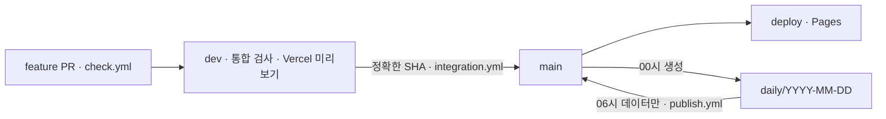

# 브랜치·환경·자동 승격·배포

**기능 코드는 `feature` → `dev`(보호된 Vercel) → 정확한 SHA로 `main`·`deploy`(GitHub Pages)에 승격하고, 일일 자료는 `main` 기반 `daily/YYYY-MM-DD`에서 데이터만 선별 반영합니다.** 두 경로를 나눠 미완성 코드가 다음 날 자동 발행에 섞이지 않게 합니다. 일일 발행 절차 자체는 [런북](../planning/runbook.md), 커밋 형식은 [커밋 기준](commits.md)에 있습니다.

[문서 안내](../README.md) · [공통 작업 지침](../../AGENTS.md) · [기술 구조](architecture.md) · [변경 기록](changelog.md)

## 브랜치와 환경

| 브랜치 | 역할 | 반영 경로 | 공개·접근 |
| --- | --- | --- | --- |
| `feature/<기능명>` | 기능 하나의 구현·검증 | 폴더·역할별 커밋, 기능 하나의 PR로 `dev`에 제안 | — |
| `dev` | 배포 준비가 된 기능의 통합 검증 | 준비된 PR만 병합. 일일 발행의 코드 원본으로 쓰지 않음 | Vercel `korea-jogan-dev`, 모든 배포에 Authentication |
| `main` | 검토·승격한 안정 코드 + 공개 데이터 | 코드 승격 또는 일일 데이터의 제한된 반영 | — |
| `deploy` | GitHub Pages 공개 기준 | 검증한 `main`을 반영 | [korea-jogan.com](https://korea-jogan.com/) 공개 |
| `daily/YYYY-MM-DD` | 그날의 조사·초안·색인·실제 추적 갱신 | `main`에서 생성, 허용 데이터만 가져오기 | — |

`dev/web/`는 브랜치가 아닌 디렉터리이며 모든 브랜치에서 같은 경로를 사용합니다. 미완성·배포 보류 기능은 피처 브랜치에 남깁니다. `dev`를 승격하면 포함된 기능이 모두 올라가므로 대상 목록을 먼저 확인합니다. 운영의 일일 자료가 `main`에 쌓이면 코드 승격 전에 그 이력을 `dev`가 포함하도록 통합하고 다시 검증합니다. 세 브랜치를 매일 같은 커밋으로 맞추지 않으며 공개된 이력을 다시 쓰거나 강제 push하지 않습니다.

## 코드 승격 순서

1. 원격을 가져와 `main`·`dev` 관계를 확인하고, 새 일일 자료·안정 수정이 있으면 그 `main` 이력을 `dev`에 포함합니다.
2. 최신 통합 기준에서 `feature/<기능명>`을 만들고 목적·폴더·역할별 커밋을 나눕니다. PR은 기능 하나로 묶습니다.
3. 기능별 검사·빌드·배포 준비를 마친 PR만 `dev`에 병합합니다. 통합된 `dev`의 **정확한 40자리 SHA**를 고정합니다.
4. `integration.yml`이 한 실행 환경에서 전체 검사 → `verify-ci` 증거 기록 → 같은 SHA의 Vercel 배포 성공·익명 접근 차단(루트·색인·관리자가 로그인으로 302)·조상 관계 확인 → `release-YYYYMMDD-<SHA 7자리>` 태그와 `main`·`deploy`를 원자적으로 반영 → Pages 호출을 이어 갑니다. 수동 SHA 입력은 필요 없습니다.
5. 해당 SHA의 Pages 성공과 공개 `build-info.json`의 `sourceSha`·`issueDate`를 확인한 뒤 완료로 기록합니다. 호출 응답·태그 생성만으로 끝내지 않습니다.
6. 검증 뒤 코드·데이터·기준 브랜치가 바뀌면 승격하지 않고 다시 검사합니다. 다른 SHA의 성공을 쓰거나 검사를 약화하지 않습니다.

태그는 특정 커밋을 가리키며 이동·삭제·덮어쓰기하지 않습니다. 문서만의 PR과 일일 기사·최신 숫자 갱신에는 기능 릴리스 태그를 만들지 않습니다. 통합 실패 뒤에는 `promote.yml`이 이미 통과한 같은 SHA의 검사 증거를 재사용해 누락된 승격·배포만 복구합니다. 이관 전 커밋은 기존 `data`·`browser` 검사 둘 다를 요구하며 새 전체 검사 실패를 과거 성공으로 대체하지 않습니다.

## 워크플로와 실행 환경

| 파일 | 트리거 | 책임 |
| --- | --- | --- |
| [check.yml](../../.github/workflows/check.yml) | PR(`dev`·`main`·`deploy` 대상), `daily/**` push | 쓰기 권한 없이 [공통 검사 작업](../../.github/actions/verify/action.yml) 실행 = `verify-ci` |
| [integration.yml](../../.github/workflows/integration.yml) | `dev`·`main` push, 고정 SHA 재검사 | 전체 검사 증거 기록 → 태그·승격·배포 요청 |
| [promote.yml](../../.github/workflows/promote.yml) | 통합 검사 완료 이벤트, 수동 | 통합 실패 뒤 같은 SHA의 검사 증거로 누락된 승격·배포만 복구 |
| [publish.yml](../../.github/workflows/publish.yml) | KST 06:00·06:07·06:37·07:17·08:17 (`main` 참조, 15분 제한) | 오늘 `daily` SHA의 CI 확인 → 허용 데이터만 준비 → 자동 승인 → `main`·`deploy` 반영 → Pages 호출 |
| [deploy-pages.yml](../../.github/workflows/deploy-pages.yml) | `deploy` push, 수동, 평일 KST 09:17~22:17 매시 | `validate --deploy` → RSS·사이트맵·호별 HTML·`live.json`·`build-info.json` 생성 → Pages → 공개 확인. 실패 시 같은 소스로 최대 두 번 재시도 |
| [daily.yml](../../.github/workflows/daily.yml) | 수동 | RSS·ECOS 원자료 수집. 조사 예약을 대체하지 않음 |

공통 검사 작업은 데이터 검사·토큰 CSS 일치·Python 시험·PR 커밋 제목·브라우저 검사 6개 파일(`smoke`·`admin`·`security`·`discovery`·`preview`·`daily`)을 한 실행 환경에서 수행합니다. `run.cjs`가 Chromium 엔진 하나를 시작하고 검사 파일이 연결하며(최대 2개 동시), 연결별 컨텍스트·쿠키 격리와 한 연결 종료가 다른 연결을 닫지 않는지도 확인합니다. 검사를 삭제하거나 경로 필터로 건너뛰지 않습니다.

2026.11.05 비교: 기존 PR 검사([41979133754](https://github.com/MinsangKwak/korea-jogan/actions/runs/41979133754))는 브라우저 108초·데이터 12초·커밋 8초의 실행 환경 3개(분 단위 올림 4분), `main` 검사([41979772369](https://github.com/MinsangKwak/korea-jogan/actions/runs/41979772369))는 실행 환경 2개(3분)였습니다. 실행 기록 비교이며 청구 금액이 아닙니다.

`GITHUB_TOKEN` push는 후속 Actions를 자동 시작하지 않으므로 새 데이터를 반영한 뒤 배포를 명시적으로 호출합니다. 시간당 배포는 SHA가 같아도 `builtAt`이 이번 결과와 같아야 공개 완료로 봅니다([verify_publication.py](../../dev/pipeline/publish/verify_publication.py)).

## 개발 미리보기 (Vercel)

2026.11.04 확인 기준. 설정 등록·실제 배포·DNS 연결·사용자 네트워크 접속은 서로 다른 확인 항목입니다.

| 항목 | 값 |
| --- | --- |
| 팀·프로젝트 | `minsangkwaks-projects`(Hobby) · `korea-jogan-dev` · Git `MinsangKwak/korea-jogan` · OWNER 1명 |
| 배포 대상 | [vercel.json](../../vercel.json): `dev` 브랜치만, `buildCommand` = [build_preview.py](../../dev/pipeline/build/build_preview.py), 출력 `dist-preview` |
| 보호 | 모든 배포에 Vercel Authentication. 로그인과 프로젝트 접근 권한은 별개 |
| 주소 | [보호된 기본 주소](https://korea-jogan-dev-git-dev-minsangkwaks-projects.vercel.app) · `dev.korea-jogan.com` |
| DNS | Gabia `CNAME dev → 7e4c24757c5a10ba.vercel-dns-017.com.`(TTL 600). 루트 A 레코드 유지, `cname.vercel-dns.com.` 중복 추가 금지. Vercel HTTPS 확인 이력 있음, 사용자 PC NXDOMAIN은 별도 확인 |

| 항목 | 개발 미리보기 | 운영 |
| --- | --- | --- |
| 접근 | Vercel Authentication | 공개 |
| 검색 | HTML `noindex` + 응답 헤더(`X-Robots-Tag`, `no-store`) | 공개 페이지 검색 허용 |
| 측정 | GA4 비활성 | 운영자·자동화 제외 후 GA4 |
| 관리자 | 개발·읽기 전용 안내 | 발행 현황 + 권한 있는 계정의 GA4·검색 조회 |
| 데이터 | 공개 호만(`preview-build.json`에 브랜치·SHA·포함 호 기록) | 배포 검사 통과 공개 호(`build-info.json`) |

`noindex`는 접근 권한이 아닙니다. 로컬 확인은 `python3 dev/pipeline/build/build_preview.py && python3 -m http.server -d dist-preview 8001`이며 인증은 재현되지 않습니다.

## 일일 발행 경로의 보호 조건

[prepare_daily.py](../../dev/pipeline/publish/prepare_daily.py)가 안정 `main` 작업본에서 고정 소스 SHA의 오늘 JSON·색인·추적 자료만 가져옵니다. 다음이면 중단합니다.

- 변경 파일이 오늘 호·`index.json`·`trackers.json` 밖에 있음(코드·과거 호·검사 스크립트 혼입)
- 색인이 `main`의 기존 날짜를 보존하지 않거나 `latest`가 오늘이 아님
- 조사 시작 뒤 `main`의 오늘 호·추적 자료가 바뀜(동시 변경)
- 추적 자료가 `updated`만 바꿨거나 `updated`가 발행일과 다름
- 같은 날짜가 이미 `published`로 공개됨(중복 발행 안 함)

`publish.yml`은 확인 중 `main`·`daily`가 바뀌었거나 둘이 조상 관계가 아니면 push하지 않습니다. 일일 브랜치의 소스 코드는 실행하지 않습니다.

## 실패와 복구

| 증상 | 먼저 확인할 내용 |
| --- | --- |
| 개발 코드가 승격 안 됨 | 정확한 SHA의 `verify-ci`·Vercel 배포 상태·조상 관계 |
| 개발 주소가 안 열림 | Gabia DNS·Vercel 도메인 확인·배포 보호 권한 |
| 브랜치 반영 뒤 화면이 그대로임 | Pages 실행·배포 대상 SHA·공개 색인·`build-info.json` |
| 자동 실행 이력이 갈라짐 | `main`·`deploy`·대상 코드의 관계. 필요한 이력을 보존해 정리 |
| 오늘 호가 없거나 공개 안 됨 | [런북의 장애 추적 순서](../planning/runbook.md#장애-추적-순서) |

강제 push·전체 개발 브랜치 병합·빈 커밋으로 검사를 우회하지 않습니다.

일일 누락 복구는 안정 `publish.yml`의 `publish_pending.py`가 최근 7일에 실제 존재하는 일일 원본만 선별합니다. 기존 과거 호는 덮어쓰지 않으며 최신 날짜·운영 코드·더 최근 추적 기록을 보존합니다. 오늘 원본이 없으면 확인 범위를 밝힌 RSS 보조 초안을 생성하고 같은 원본 SHA의 전체 검사를 거쳐 발행합니다. 상세는 [런북](../planning/runbook.md#자동-발행-누락-복구--20261112)을 따릅니다.
