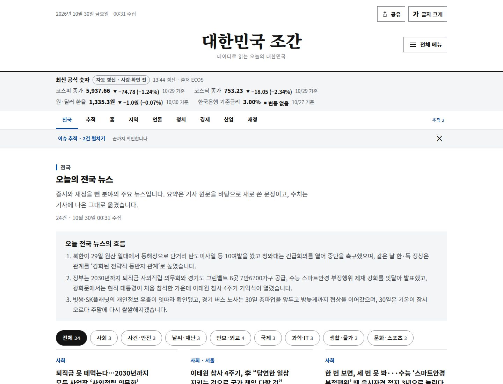

# 변경 기록

**날짜별 기능 배포·운영 확인을 최신순으로 모았습니다.** 각 항목의 검사 수·호 수·화면 배치·예약 시각은 **그 시점의 값**이며 현재 기준은 [기술 구조](architecture.md)·[디자인 가이드](../../design/guide.md)·[런북](../planning/runbook.md)을 따릅니다. 검증 수치는 기능 검사 결과이고 이용자 성과·접근성 인증·모든 브라우저 호환을 뜻하지 않습니다.

[문서 안내](../README.md) · [브랜치·환경·배포](branches.md) · [GA4·검색 연결](ga4-admin.md)

| 날짜 | 범위 | 반영 근거 |
| --- | --- | --- |
| 2026.11.09 | 브라우저 검사 대기 조건 수정·지연 발행 복구·문서 통합 | PR #109·#110, `48ef4d4`·`74ca1bf` |
| 2026.11.05 | 발행 복구·CSP 검사 대기 수정·운영 지면 확인 | PR #99·#100·#101, `d5b493a` |
| 2026.11.04 | 개발 미리보기(Vercel)와 일일 발행 분리 | PR #91·#92, `f4df437b` |
| 2026.11.04 | 검색 도착 페이지(`/archive/`·`/topics/`·`/indicators/`)·유입 점검 | PR #91, `6e3a19e` |
| 2026.11.03 | 섹션 배치·모바일 접기·경제 순환(Swiper) | PR #86·#87, `1d6880f` |
| 2026.11.03 | 1,600px 지면·픽셀 삽화·메타 CSP | `98a6d9f` |
| 2026.11.03 | 두괄식 문구·라이트/다크 테마 | — |
| 2026.10.30 | 전국 1면·이슈 추적 2면·신문형 지면 | PR #67~#70, `f89c3f3` |
| 2026.10.23 | 발행 검사 강화·로딩/오류 경계·모바일 안정화 | `158314f` 기준 확인 |

## 2026.11.09 브라우저 검사 대기 조건 수정과 지연 발행

| 항목 | 확인한 내용 |
| --- | --- |
| 증상 | `daily/2026-11-09`의 CI가 `smoke.cjs` `#natList` 1920 폭 짝 읽기 검사에서 실패. 재실행해도 같은 수치 |
| 범위 확인 | 같은 실패가 `main`(`64ddce4`) 수동 검사에서도 재현, 로컬 Chromium에서는 통과 → 데이터가 아닌 검사 쪽 문제 |
| 직접 원인 | '더보기' 직후 `pairedSize()`가 `paired-reading.js`의 ResizeObserver → requestAnimationFrame 갱신 전 상태를 측정 |
| 수정 | 두 열 높이 일치에 더해, 넘치는 열마다 `data-paired-overflow`가 붙을 때까지 기다린 뒤 측정. 단언은 유지 |
| 반영 | 수정 SHA `48ef4d4`의 전체 검사 통과를 확인한 뒤 운영자 승인으로 `main`에 직접 반영(PR #110은 `dev`용). 일일 브랜치를 그 위로 재배치해 CI 통과 후 `publish.yml`로 `74ca1bf` 자동 발행·Pages 배포 |
| 함께 반영 | 문서 32개 → 18개 통합(PR #109 내용을 `main`에 적용) |

[실패한 main 검사](https://github.com/MinsangKwak/korea-jogan/actions/runs/42570786738) · [수정 후 main 검사](https://github.com/MinsangKwak/korea-jogan/actions/runs/42573784141) · [PR #110](https://github.com/MinsangKwak/korea-jogan/pull/110)

## 2026.11.05 발행 복구와 운영 확인

### 멈춘 원인과 수정

| 항목 | 확인한 내용 |
| --- | --- |
| 첫 초안 | `daily/2026-11-05`의 `ab64f41`. 호는 `draft`, 데이터 검사 성공, 브라우저 검사 실패 |
| 실패 위치 | `dev/tests/browser/security.cjs`의 관리자 공개 호 표시(`#publishData`) 대기 |
| 직접 원인 | 임시 공개용 HTML은 `published` 호만 생성했지만 관리자가 읽는 JSON 색인에는 최신 초안이 남아 HTML과 JSON이 다른 호를 가리킴 |
| 수정 | `build_pages.published()`로 공개 호를 고르고 `published_index()`로 임시 색인을 쓴 뒤 HTML 생성. 관리자 최신 호가 색인과 일치하는지도 검증 |
| 유지한 것 | 초안 배포 차단·CSP·일일 SHA의 CI 확인 조건 |

[실패한 초안 CI](https://github.com/MinsangKwak/korea-jogan/actions/runs/41855133036) · [수정 PR #99](https://github.com/MinsangKwak/korea-jogan/pull/99) · [커밋 46be0e6](https://github.com/MinsangKwak/korea-jogan/commit/46be0e6b74edb57dba5a5b157fd1f140111c7b00)

### 복구 순서

| 단계 | 결과·근거 |
| --- | --- |
| 일일 후보 검사 | 수정본 포함 후보 `2627e7f`의 `data`·`browser` 성공 ([CI](https://github.com/MinsangKwak/korea-jogan/actions/runs/41940255196)) |
| 안정 코드 수정 | PR #99를 `main`에 병합한 `57737ae` CI 성공 ([CI](https://github.com/MinsangKwak/korea-jogan/actions/runs/41941094296)) |
| 운영자 발행 복구 | 사용자 요청으로 `d5b493a`를 `main`·`deploy`에 반영. `review.auto: true`, 확인 시각 09:24 |
| 운영 배포 | 09:26 Pages 성공 ([배포](https://github.com/MinsangKwak/korea-jogan/actions/runs/41941307746) · [CI](https://github.com/MinsangKwak/korea-jogan/actions/runs/41941292476)) |
| 실제 공개 대조 | 14:41 공개 색인 `latest: 2026-11-05`, 호 JSON `published`·`review.auto: true`, `build-info.json` `production`·`sourceSha: d5b493a…`·`issueDate: 2026-11-05`. 세 주소 모두 HTTP 200 |

이 공개는 아침 예약의 최초 발행이 아니라 운영자 요청에 따른 복구입니다. 자동 발행 표시는 사람의 원문 대조를 뜻하지 않습니다.

### 아침 예약의 후속 결과

초기 진단에서는 오늘 발행 실행 기록이 없었습니다. 이후 `schedule` 실행 4건(10:24:56 · 10:44:07 · 11:29:23 · 12:28:43, 실행 [41948361536](https://github.com/MinsangKwak/korea-jogan/actions/runs/41948361536)·[41950508640](https://github.com/MinsangKwak/korea-jogan/actions/runs/41950508640)·[41955536178](https://github.com/MinsangKwak/korea-jogan/actions/runs/41955536178)·[41961843253](https://github.com/MinsangKwak/korea-jogan/actions/runs/41961843253))이 모두 성공했습니다. 이미 공개된 호를 감지해 초안 가져오기·자동 발행·배포 재호출을 건너뛰고 날짜·빌드 SHA만 확인했습니다. 예약이 늦게 시작한 원인은 미확인이며 보안 검사 오류와 같은 원인으로 단정하지 않습니다.

### 자동화 이관 상태 (2026.11.05 기준)

| 항목 | 상태 |
| --- | --- |
| 기존 Claude 00:00 조사·06:05 보조 예약 | 2026.11.04 꺼짐. 다시 켜지 않음 |
| Codex 00:00 조사·초안·편집 | 11/05 첫 실행으로 `daily/2026-11-05`에 초안 저장 |
| Codex 06:05 공개 확인 | 첫 실행(06:16)에서 미공개·브라우저 검사 실패를 진단·보고 |
| Codex 06:05 발행 실행·재시도 | 사용자가 검토 없는 자동 완료를 승인해 허용. 현재 버전·소스 SHA·진행 중 실행 확인 후 안정 발행만 시작·재시도 |
| GitHub 아침 발행 | 06:00 추가, 기존 06:07·06:37·07:17·08:17 유지 |

2026.11.03 이전 구조는 `dev` 전체를 `main`·`deploy`로 빨리 감기했고, `main` 병합 커밋이 `dev`에 빠져 아침 발행이 멈춘 기록이 있습니다. 현재 구조는 데이터를 선별 반영하고 조상 관계를 따로 확인합니다. 빠진 날짜는 소급 생성하지 않습니다.

### CSP 검사의 간헐 실패 수정

문서 PR #100 병합 후 검사와 PR #101의 `dev` 통합 검사에서 `object-src 미차단`이 간헐적으로 발생했습니다. `security.cjs`는 CSP 이벤트가 5개 이상이면 결과를 읽었는데, 인라인 코드와 외부 스크립트가 각각 `script-src-elem` 이벤트를 만들어 5개가 모여도 `object-src` 이벤트가 아직 도착하지 않을 수 있었습니다.

| 확인 조건 | 기존 검사 | 수정 검사 |
| --- | --- | --- |
| `object-src` 이벤트 200ms 지연 | 실패 재현 | 홈·지난 호·관리자 3경로 통과 |
| `object-src` 이벤트 누락 | 비교 대상 아님 | 시간 초과로 실패(누락을 통과시키지 않음) |
| 일반 흐름 | 성공·간헐 실패 | 3경로 통과 |

완료 조건을 이벤트 **개수**에서 필요한 지시어 **전체 관측**으로 바꿨습니다. 지연·누락 주입은 임시 검사본에서만 수행했고 공개 CSP·화면 코드는 바꾸지 않았습니다.

### 당시 운영 지면 (11/04 PR #94~#98 반영)

| 영역 | 동작 |
| --- | --- |
| 읽기 도구 | 상단 삽화 제거, 본문 18~19px·크게 보기 23px, 글자·화면 모드는 같은 모양의 테두리 없는 스위치 |
| 화면 모드 | 라이트 기본. 선택 시 `#181818` 배경·`#252526` 상위 면의 다크, 읽기 설정 저장 |
| 전국 뉴스 | 본문 한 편과 제목 목록 분리 |
| 일정·재정·추적 | PC 두 열은 짧은 쪽 높이에 맞추고 긴 쪽만 스크롤, 모바일은 자연 높이 |
| 경제·주력산업 | 비교 목록의 수치·버튼 위치 통일, 선택 항목의 설명·출처는 목록 아래 공용 상세 |
| 브랜드 | `ㅈ` 심벌·로고·파비콘·`og-first-light.png` |

[#94](https://github.com/MinsangKwak/korea-jogan/pull/94) · [#95](https://github.com/MinsangKwak/korea-jogan/pull/95) · [#96](https://github.com/MinsangKwak/korea-jogan/pull/96) · [#97](https://github.com/MinsangKwak/korea-jogan/pull/97) · [#98](https://github.com/MinsangKwak/korea-jogan/pull/98)

남은 확인: GitHub 예약 지연 원인, 사용자 네트워크에서의 `dev.korea-jogan.com` 접속, `dev`(`33efeb0`)와 운영(`d5b493a`)의 SHA 차이를 다음 승격 전 정리.

## 2026.11.04 개발 미리보기와 일일 발행 분리

`dev`의 실험 코드가 아침 발행에 함께 공개되는 경로를 없앴습니다. 현재 운영 기준은 [브랜치·환경·배포](branches.md)에 있습니다.

| 항목 | 이전 | 이번 기준 |
| --- | --- | --- |
| 개발 검토 | `dev`와 운영 발행 경로가 연결 | `dev`는 보호된 Vercel 미리보기 |
| 일일 조사 | `dev`에 초안 저장 | `main`에서 만든 `daily/YYYY-MM-DD`에 오늘 자료만 |
| 아침 발행 | `dev` 전체를 `main`·`deploy`로 빨리 감기 | 고정 `daily` SHA의 허용 데이터만 `main`에 반영 |
| 코드 공개 | 세 브랜치 일괄 동기화 | 정확한 `dev` SHA의 CI·Vercel 배포·조상 관계 확인 후 승격 |

| 확인 | 기록 |
| --- | --- |
| Vercel | `minsangkwaks-projects` Hobby, 프로젝트 `korea-jogan-dev`, 모든 배포에 Authentication, OWNER 1명 |
| 첫 Vercel 배포 | [`f4df437b`](https://vercel.com/minsangkwaks-projects/korea-jogan-dev/EQcoTBWNJtHv8bAjHEn6gwogBsEN) READY. 인증 연결로 `preview-build.json` 200(`branch: dev`·최신 호 2026-11-04·17개 호·`noindex`·비공개 캐시 헤더). 비로그인 `/`·색인·스크립트는 302 |
| 소스·CI | [PR #91](https://github.com/MinsangKwak/korea-jogan/pull/91) → `f4df437b`. Python 144건·브라우저 114건 |
| 초기 운영 반영 | 전환 중 기존 예약 발행이 `f4df437b`를 `main`·`deploy`에 반영. [Pages #41755244224](https://github.com/MinsangKwak/korea-jogan/actions/runs/41755244224) 성공, `build-info.json` 동일 SHA·`issueDate: 2026-11-04`, 사이트맵 29개 주소. 새 `promote.yml` 실행 기록은 아님 |
| 후속 승격 검사 | 원시 Vercel 상태 응답 대조 로컬 22건·Python 147건. [PR #92](https://github.com/MinsangKwak/korea-jogan/pull/92) |
| DNS | 당시 NXDOMAIN. 이후 가비아 CNAME `dev` → `7e4c24757c5a10ba.vercel-dns-017.com.`(TTL 600) 등록 |
| Codex 예약 | 00시 `main` 기반 `daily` 작성, 06:05 읽기 전용 확인으로 지시 갱신(이후 11/05 실행·재시도로 확대) |

## 2026.11.04 검색 도착 페이지와 유입 점검

공개 호 17개·추적 사안 2개·핵심 지표 6개를 `/archive/`·`/topics/<사안>/`·`/indicators/<지표>/` 고정 주소로 재구성했습니다. 새 취재나 실시간 지표가 아니며 호 발행일과 원자료 기준일은 다를 수 있습니다.

| 항목 | 상태 |
| --- | --- |
| 기준 배포본 | 2026.11.04 자동 발행 후 `6e3a19e` |
| 검사 | Python 88개·공개 호 17개 배포 검사·토큰 CSS. 브라우저: 공개 69·관리자 21·보안 3·검색 지면 8(새 페이지 11개의 무스크립트 본문·320/390/1440px·테마·측정) |
| 반영 | [PR #91](https://github.com/MinsangKwak/korea-jogan/pull/91) |
| 실제 검색 성과 | 미확인 |

배경이 된 11/04 관리자 캡처(최근 28일 방문자 121·조회 126·세션 131·평균 참여 4초, Direct 127·Organic 2·Referral 2)와 측정 기준 변경(10/25 제목 고정, 10/27 섹션·3초 문턱, 10/30 자동화·내부 방문 제외 `46ea5c5`)의 해석 기준은 [검색·소개·재방문 운영](../planning/growth.md)에 있습니다.

## 2026.11.03 섹션 배치와 모바일 읽기

기사·수치·출처 데이터는 바꾸지 않았습니다. 기능 커밋 [`1d6880f`](https://github.com/MinsangKwak/korea-jogan/commit/1d6880f8477de8dcdf75aae2160424525cbe326f), [PR #86](https://github.com/MinsangKwak/korea-jogan/pull/86) squash → [PR #87](https://github.com/MinsangKwak/korea-jogan/pull/87) 빨리 감기, [배포 #41594303931](https://github.com/MinsangKwak/korea-jogan/actions/runs/41594303931).

| 영역 | 넓은 화면 | 좁은 화면 |
| --- | --- | --- |
| 이슈 추적 | 1,100px부터 사안 카드 두 개, 본문 `min(72dvh, 42rem)` 스크롤 | 한 열, 상세 근거는 건수 표시 펼침 |
| 머리기사 옆 목록 | 901px부터 왼쪽 자연 높이에 맞춰 스크롤(grid stretch·`contain:size`) | 보조 목록 기본 접기 |
| 언론 검색 | 1,100px부터 제목 왼쪽·검색 오른쪽 | 설명 아래 전체 폭 |
| 산업 비교 | 1,100px부터 요약 왼쪽·그래프 오른쪽(1:1.2) | 세로, 900px 이하 그래프 접기 |
| 경제 | 3~4개 함께 보며 순환 | 한 카드 중심 |

Swiper 14.4.0을 [로컬 vendor](../../dev/web/assets/vendor/swiper/README.md)에 보관(라이선스·원본·SHA-256 기록, CDN·CSP 출처 추가 없음). 자동 넘김 8초, 호버·포커스·화면 밖·숨긴 탭·터치·출처 열기·동작 줄이기에서 정지, 로드 실패 시 전체 격자 유지.

검사: Python 56, 공개 Chromium 68, 관리자 21, CSP 3(자동 검사 148건), 16개 호 배포 규칙·토큰, 운영 사이트 34건.

## 2026.11.03 지면·삽화·보안

기능 배포 기준 [`98a6d9f`](https://github.com/MinsangKwak/korea-jogan/commit/98a6d9f712471f1daff7ac14cb653cf1161fe97b).

| 영역 | 적용 |
| --- | --- |
| 지면 | 최대 1,600px, PC 32px·모바일 20px 여백. 카드 PC 24px·모바일 20px |
| 읽기 설정 | 글자 확대 토글(`aria-pressed`), 화면 모드 선택 목록. 전체 메뉴 상단에 모음 |
| 추적 정보 | 1,100px·창 600px 이상에서 오른쪽 고정(당시 배치, 이후 두 열 카드로 변경) |
| 푸터 | 브랜드·읽기 안내 / 수집 한계·출처 / 지난 호·정정 / 제작·라이선스. 1,024px 이하 한 열, 128px 이동 여백 |
| 삽화 | 제호 아래 AI 생성 픽셀 삽화(모바일 720px WebP 약 62KB, PC 1,536px 약 206KB), OG `og-pixel.png` — 이후 11/04 브랜드 개편으로 삽화 제거·‘첫 빛’ OG로 교체 |

메타 CSP 도입: [build_security.py](../../dev/pipeline/build/build_security.py)가 최종 HTML의 인라인 실행 코드 SHA-256을 계산. 자체 코드와 GA4·GoatCounter·Google 인증(및 GA4 연동용 Google/DoubleClick/신디케이션·Tag Manager 프레임)만 허용, 임의 인라인·이벤트 속성·eval·object·base·worker 차단, 외부 글꼴 onload를 비동기 스크립트로 이동, referrer 경로 비전달. 그래프 때문에 인라인 스타일은 허용. GitHub Pages는 응답 헤더를 못 쓰므로 `frame-ancestors`·HSTS·`X-Frame-Options`·`nosniff`는 미적용. 참고: [MDN CSP](https://developer.mozilla.org/en-US/docs/Web/Security/Practical_implementation_guides/CSP) · [frame-ancestors 메타 미지원](https://developer.mozilla.org/en-US/docs/Web/HTTP/Reference/Headers/Content-Security-Policy/frame-ancestors) · [Google 인증 CSP](https://developers.google.com/identity/gsi/web/guides/get-google-api-clientid) · [GA4 CSP](https://developers.google.com/tag-platform/security/guides/csp).

검사: Python 56, 공개 Chromium 57, 관리자 21, CSP 3, 16개 호·토큰.

## 2026.11.03 두괄식 문구와 화면 모드

| 영역 | 변경 |
| --- | --- |
| 문구 | 최신호 서술 55개 필드와 추적 `summary`·`next`·`note` 6개를 결론 먼저로 재배치. 숫자·링크·날짜·`review`·단계 상태 보존 |
| 긴 요약 | `ui.js` `readingText`로 첫 문장 분리(원본 문자열 유지) |
| 화면 모드 | `theme.js`: 기기 설정·라이트·다크, 저장, 전체 메뉴·관리자·다른 탭 동기화 |
| 색 대비 | 토큰 기반 배지 대비 4.5:1 이상, `build_tokens.py`가 라이트·다크 선택자와 `color-scheme` 생성 |

검사: Python 53, 공개 Chromium 51, 관리자 21, 16개 호·토큰.

## 2026.10.30 전국 1면·이슈 추적 2면

배포 커밋 [`f89c3f3`](https://github.com/MinsangKwak/korea-jogan/commit/f89c3f393ab01e4691cf514cb979611a6573994f). 읽는 순서를 전국 → 이슈 추적 → 홈 → 지역 → 언론 → 정치 → 경제 → 산업 → 재정으로 바꾸고 신문형 지면(명조 제호, 1,120px 본문)을 적용했습니다.

| 영역 | 변경 |
| --- | --- |
| 추적 UI | 상단 막대(기본 접힘, 세션 숨김, `추적 2`로 재진입), 패널에 요약·단계·다음 확인·기사 표·타임라인. 지난 호에는 미표시 |
| 무안공항 자료 | 기사 4건을 보도일·매체·원문·확인 범위로 기록. 10/28 보도 근거로 전문 분석 단계, 최종 발표일은 미확정 ([대조 기록](../research/muan-airport-20261030.md)) |
| 검사 | 빈 `themes` 거부, 전체 초기화를 한 오류 경계로, 추적 `phases`·`phaseIndex`·`periodUnknown` 모순 검사 |
| 기타 | 버튼 `brand`/`on-brand` 동시 전환(다크 글자 흐림 수정), 맨 위로 PC·모바일 모두 표시, 미정의 `space-5` 수정 |

검사: Python 52, 공개 Chromium 39, 관리자 20, 운영 320·390·1440px 라이트·다크(선택 대비 8.13·8.72·8.13). [PR #67](https://github.com/MinsangKwak/korea-jogan/pull/67)·[#68](https://github.com/MinsangKwak/korea-jogan/pull/68)·[#69](https://github.com/MinsangKwak/korea-jogan/pull/69)·[#70](https://github.com/MinsangKwak/korea-jogan/pull/70)

## 2026.10.23 발행 검사 강화와 모바일 안정화

`158314f` 공개 데이터 기준. 공개 호 5개, 최신 호 자동 발행 08:47(예약 06:00보다 2시간 47분 지연), 전국 24건·시도 48건·주제 3개. TTFB 첫 화면 5,127ms·색인 5,133ms·JSON 5,054ms(작업 환경 측정, 이용자 평균 아님).

| 영역 | 적용 |
| --- | --- |
| 발행 검사 | 빈 주제·잘못된 중첩·중복 주제 ID·비교 표 열 수 불일치·깨진 JSON/색인 차단 |
| 화면 복구 | 초기화 전체를 오류 경계로, 성공 후 정적 요약 제거, 실패 시 요약·재시도 유지 |
| 첫 진입 | 배포 HTML에 호 JSON·색인 내장(요청 2건 제거), 삽입 JSON의 `<` 이스케이프 |
| 로딩 | 데이터 요청 12초 제한, 스크립트 누락 20초 후 재시도·정적 요약 |
| 측정 | GA4 `app_ready`·`app_load_error`·`duration_ms` |

검사: 5개 호 배포 검사·토큰, Python 42, Chromium 22 시나리오(320~1440px). 외부 정적 UI 검사의 "인라인 이벤트 없음" 9건은 별도 JS 연결을 인식하지 못한 결과이며 통과로 보고하지 않음.
