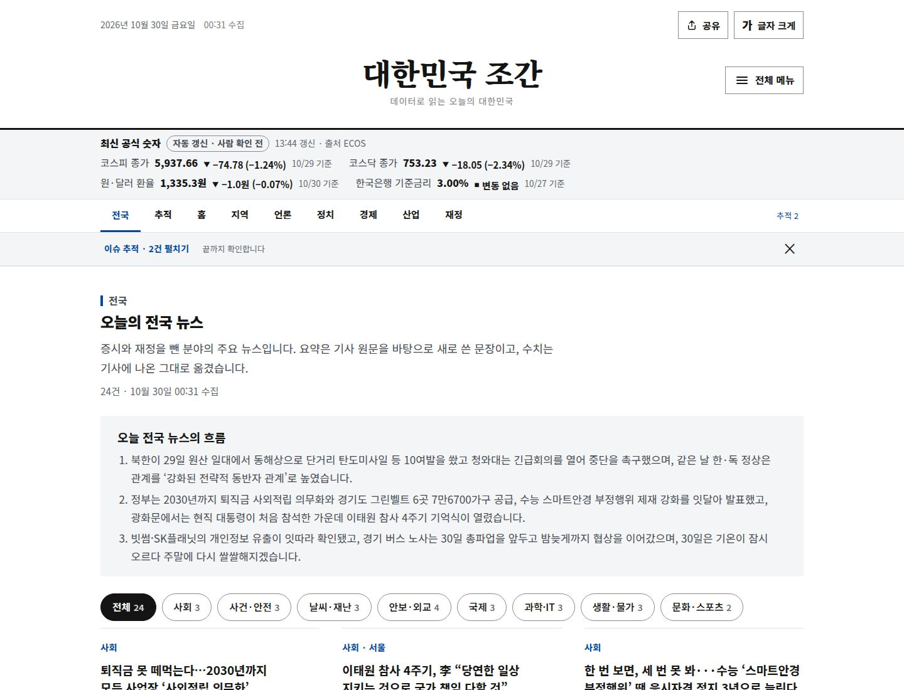
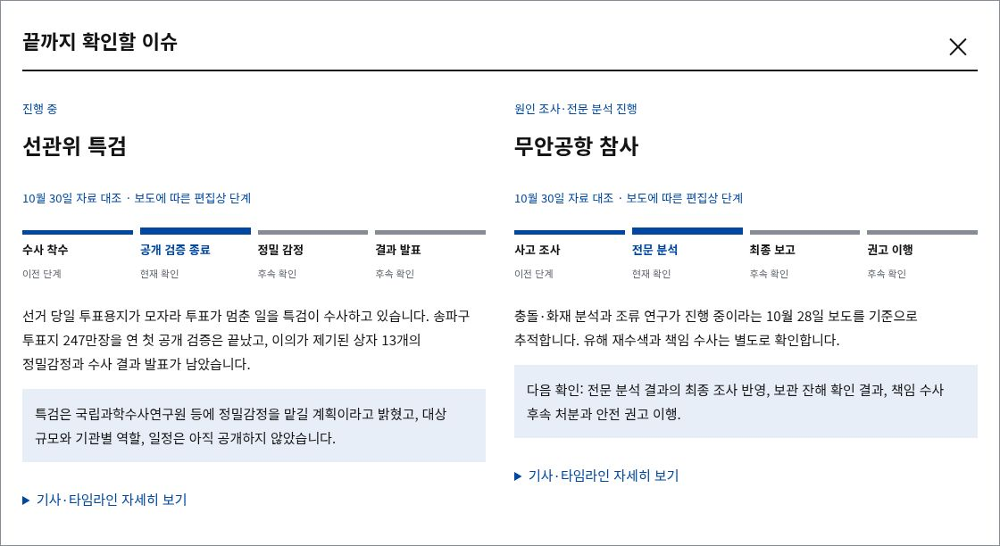
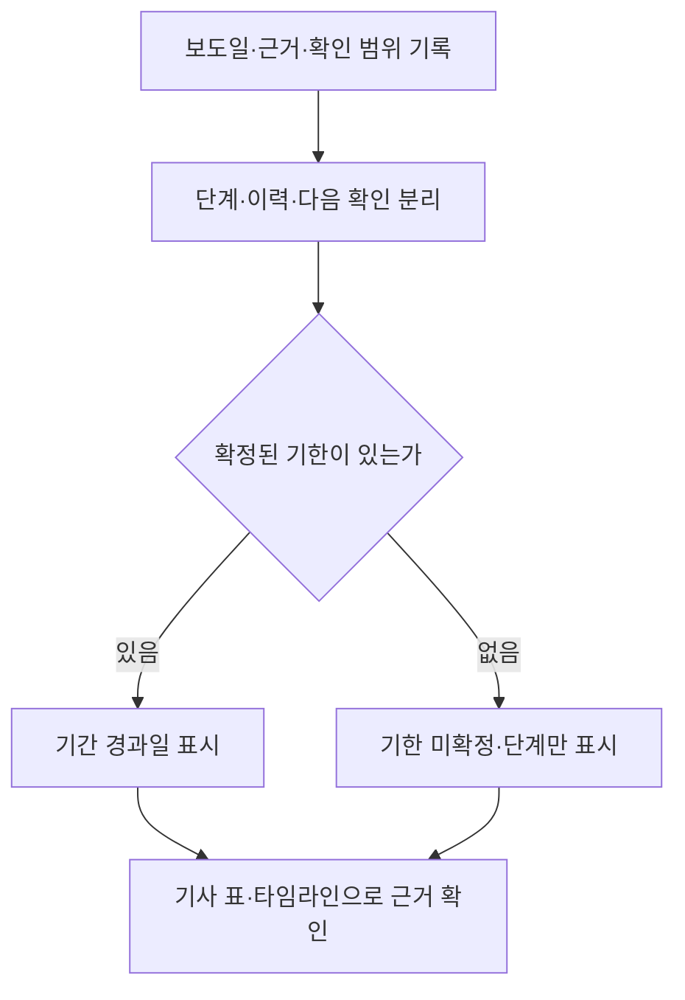

# 뉴스 지면·이슈 추적 개선 기록

**전국 뉴스와 장기 이슈를 먼저 읽고, 숫자의 기준과 원문까지 확인하는 흐름으로 지면을 정리했습니다.** 기능 기준은 2026.10.30 배포 커밋 [`f89c3f3`](https://github.com/MinsangKwak/korea-jogan/commit/f89c3f393ab01e4691cf514cb979611a6573994f)입니다. 이 문서는 구현·검증 기록이며 이용자 성과를 뜻하지 않습니다.

[운영 사이트](https://korea-jogan.com/) · [Figma 시안](https://www.figma.com/design/Eep2qLjiPT9jhDUyLU8Zjx) · [Notion 포트폴리오](https://www.notion.so/3ffcbbdd109b8167a28dd65769e55676)

## 달라진 읽기 순서

전국 → 이슈 추적 → 홈(주요 뉴스) → 지역 → 언론 → 정치 → 경제 → 산업 → 재정의 9개 섹션입니다. 전국을 1면, 추적을 2면으로 옮긴 뒤 나머지 섹션의 상대 순서를 유지했습니다.

| 영역 | 바꾼 내용 | 판단 근거 |
| --- | --- | --- |
| 신문형 지면 | 명조 제호·대표 제목, 평면 구성·구분선, 1120px 본문 | 제목·수치·출처 사이의 위계 구분 |
| 주요 뉴스 | 관련 주제 2개, 실제 발행 데이터의 경제 지표 4개 요약 | 요약에서 주제별 기사·상세 숫자로 이동 |
| 모바일 | 한 열의 문서 흐름, 상단 분야 메뉴와 전체 메뉴 | 가로 넘침과 고정 하단 메뉴의 화면 점유 축소 |
| 헤더 도구 | 로고·메뉴, 날짜·발행 상태, 공유·글자 크기 분리 | 좁은 화면에서 발행 배지와 버튼 겹침 방지 |
| 버튼 상태 | `brand` 배경과 `on-brand` 글자를 함께 전환 | 다크 모드에서 선택 버튼 글자가 흐려지던 문제 수정 |
| 맨 위로 | PC·모바일 모두 한 화면 넘게 스크롤하면 표시 | 기존 PC 숨김 규칙 제거, 이동 후 제호 포커스 복귀 |
| 기간 패널 | 상단 강조선·옅은 배경, 24px·모바일 20px 여백 | 미정의 `space-5` 참조를 수정하고 별도 정보 영역으로 구분 |

## 결론이 날 때까지 추적하는 UI

선관위 특검과 무안공항 참사를 상단 막대와 2면에서 제공합니다. 막대는 기본적으로 접어 두고, 패널 안에서 요약·단계·다음 확인 사항을 읽은 뒤 기사 표와 타임라인을 펼칠 수 있습니다.

- 숨김은 현재 세션에만 저장하며 `추적 2`로 다시 엽니다.
- 모달은 Esc·닫기·배경 클릭을 지원하고, 닫으면 읽던 위치와 포커스를 복구합니다.
- 지난 호에는 현재 추적 기록을 덧붙이지 않습니다.
- 단계 막대는 편집상 정리이며 공식 해결률이나 사건 전체의 완료율이 아닙니다.

무안공항 관련 기사 4건은 보도일·매체·제목·원문·핵심 내용·확인 범위로 구성했습니다. 10월 28일 보도를 근거로 전문 분석 단계를 표시했으며, 최종 발표일은 확정 기한으로 넣지 않았습니다. 제목·부제만 확인한 기사와 본문을 대조한 기사를 구분했습니다. 송치를 유죄 확정으로, 수색 예정일을 완료로 표시하지 않았습니다. [자료 대조 기록](../research/muan-airport-20261030.md)

## 데이터 검사와 화면 복구

빈 `themes`는 발행 검사와 브라우저 진입점에서 거부합니다. 전체 초기화·렌더링을 하나의 오류 경계에서 처리해, 성공한 뒤에만 검색용 정적 요약을 제거합니다. 로딩·데이터 오류·스크립트 누락에는 지연 안내와 요약·재시도 경로를 유지합니다.

추적 데이터는 단계 이름·현재 인덱스 범위를 검사합니다. `periodUnknown: true`일 때는 시작·종료일을 함께 넣을 수 없습니다. 형식 검사 통과가 기사 원문의 사실 확인을 대신하지는 않습니다.

[기술 구조](architecture.md) · [데이터 규격](../planning/data-spec.md) · [운영 절차](../planning/runbook.md)

## 검증과 배포 근거

| 검증 | 직전 기능 배포에서 확인한 결과 |
| --- | --- |
| Python | 데이터·페이지 생성 등 52건 통과 |
| 공개 지면 Chromium | 39건 통과. 최신·지난 호, 로딩·오류·검색, 추적 모달·세션 숨김·복귀, 큰 글자·가로 넘침 |
| 관리자 Chromium | 20건 통과. 연결 안내·권한 오류·만료·재조회·기간 변경·화면 폭 |
| 테마·도구 | 320·390·1440px의 라이트·다크, 선택 대비 4.5:1 이상·헤더 겹침·기간 여백·맨 위로 이동 |
| 운영 사이트 | 320px 다크·390px 라이트·1440px 다크에서 순서·여백·도구·오류 없음 확인. 선택 대비 각각 8.13·8.72·8.13 |
| GitHub Actions | 데이터·커밋 제목·브라우저·사이트 배포 성공 |

검증 수치는 해당 코드와 시점의 실행 결과입니다. 전체 브라우저 호환성이나 접근성 인증, 체류 시간·전환율 개선을 주장하지 않습니다. 실제 GA4 방문 수치를 이번 변경의 성과로 제시하지 않았습니다.

| 변경 묶음 | 반영 근거 |
| --- | --- |
| 신문형 지면·추적 패널·기사 표 | [작업 PR #67](https://github.com/MinsangKwak/korea-jogan/pull/67) · [배포 PR #68](https://github.com/MinsangKwak/korea-jogan/pull/68) |
| 버튼·PC 맨 위로·기간 여백·1면/2면 | [작업 PR #69](https://github.com/MinsangKwak/korea-jogan/pull/69) · [배포 PR #70](https://github.com/MinsangKwak/korea-jogan/pull/70) |

변경은 폴더별 커밋으로 나눠 `dev → main → deploy` 순서로 반영했습니다. 실제 기사 데이터를 Figma의 예시 문구로 대체하지 않았으며, 조사 상태는 연결된 근거와 확인 범위 안에서만 표시했습니다.

## 운영에서 이어갈 확인

전문 분석 결과의 최종 보고 반영, 수색 후속 결과, 책임 수사 처분, 안전 권고 이행은 새 근거가 나올 때 갱신합니다. GA4 관리자는 구현돼 있으나 실제 계정 연결에는 OAuth 설정과 권한이 필요합니다. [관리자 연결 절차](ga4-admin.md)
