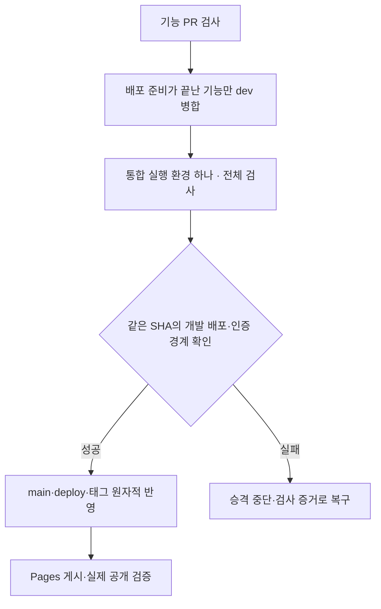

# 실행 환경을 재사용하는 자동 검사·발행·배포

**같은 커밋을 검사하는 동안 실행 환경과 브라우저 엔진을 각각 한 번만 시작합니다.** 검사 범위와 기존 배포 일정을 유지하며, 기능 코드와 매일의 기사 데이터를 다른 경로로 처리합니다.

[공통 작업 지침](../../AGENTS.md) · [자동화 운영](publish-automation.md) · [브랜치와 태그](branches.md) · [발행 런북](../planning/runbook.md)

## 반복 시작을 없앤 부분

| 구간 | 이전 | 현재 |
| --- | --- | --- |
| PR 검사 | 데이터·브라우저·커밋 제목에 각각 실행 환경 3개 | 공통 검사 작업을 한 실행 환경에서 모두 수행 |
| dev 통합 | 검사와 수동 승격을 별도 실행 | 한 실행 환경에서 전체 검사 → 증거 기록 → 태그·승격 → 배포 요청 |
| Chromium | 검사 파일 6개가 각각 엔진 시작 | `run.cjs`가 엔진 하나를 시작하고 검사 파일이 연결. 최대 2개씩 실행 |
| main 승격 | 같은 커밋의 결과를 다시 기다리거나 수동 입력 | 검증한 SHA 자체를 승격해 이미 완료한 검사 증거 사용 |
| 배포 완료 대기 | 승격 실행 환경도 별도로 켜 둔 채 Pages 대기 | 게시 권한이 필요한 Pages 작업 안에서 실제 공개를 확인 |
| 실패 복구 | 설치·전체 검사를 다시 시작하거나 수동 재실행 | 통과한 같은 SHA의 검사 증거를 재사용. Pages는 최대 두 번 재시도 |

검사를 삭제하거나 경로 필터로 건너뛰지 않습니다. 데이터 검증·토큰 일치·모든 Python 시험·PR 커밋 제목과 공개/관리자/CSP/검색/개발/일일 후보의 브라우저 6개 파일을 유지합니다. 브라우저 연결별 컨텍스트와 쿠키가 격리되고 한 연결 종료가 다른 연결을 닫지 않는지도 확인합니다.

운영 Pages는 환경 권한이 다른 별도 게시 단계입니다. 평일 09:17~22:17의 기존 14회 숫자 갱신과 새 호 배포를 유지합니다. 실행 환경을 한 번 띄우는 데 드는 최소 단위까지 없앴다고 표현하지 않습니다.

## 기능 코드의 완전 자동 승격

[integration.yml](../../.github/workflows/integration.yml)은 신뢰된 `dev`·`main` push와 고정 SHA의 자동 재검사만 처리합니다. PR·일일 CI는 쓰기 권한 없는 [check.yml](../../.github/workflows/check.yml)로 분리합니다. 두 경로는 같은 [공통 검사 작업](../../.github/actions/verify/action.yml)을 사용합니다.

통합 검사는 시작 시 `verify-ci` 증거를 진행 중으로 만들고, 모든 필수 명령을 마친 뒤 성공 또는 실패로 기록합니다. 전체 검사가 끝난 뒤 같은 실행 환경에서 [auto_release.py](../../dev/pipeline/publish/auto_release.py)를 실행합니다. 이관 전 커밋은 `data`·`browser` 둘 다 성공해야 하며 새 `verify-ci`가 실패·진행 중이면 과거 성공으로 우회하지 않습니다.

- 새 안정 이력이 있으면 `dev`에 자동 통합하고 새 SHA를 다시 검사합니다. 충돌은 임의 선택으로 덮지 않고 중단합니다.
- 같은 SHA의 GitHub Actions 검사와 지정 프로젝트의 Vercel 배포 성공을 대조합니다. 개발 루트·색인·관리자의 익명 요청이 Vercel 인증으로 이동하는지도 확인합니다.
- 개발 지면·관리자 기능과 데이터 격리는 브라우저 검사가 담당합니다. 익명 차단 확인을 로그인 후 원격 본문 열람과 같은 검사라고 표현하지 않습니다.
- `release-YYYYMMDD-<SHA 앞 7자리>` 태그와 `main`·`deploy`를 하나의 Git 트랜잭션으로 반영합니다. 기존 태그는 이동하지 않습니다.
- `GITHUB_TOKEN` push가 후속 Actions를 자동 시작하지 않으므로 Pages를 명시적으로 호출합니다. 같은 소스의 진행 중인 배포나 공개 완료 상태는 재사용합니다.
- 새 발행 워크플로 버전은 한 번 자동 실행해 예약 감독이 재사용할 실행 기록을 만듭니다. 같은 버전마다 다시 초기화하지 않습니다.

수동 SHA·`admin_preview_verified` 입력은 필요하지 않습니다. 정상 경로는 새 복구 실행 환경도 만들지 않으며, 통합 실패 때만 [promote.yml](../../.github/workflows/promote.yml)이 이미 통과한 같은 검사 증거로 복구합니다.

## 기사는 검토를 기다리지 않고 발행

00시 조사·편집은 안정 `main` 기반 `daily/YYYY-MM-DD`에 초안을 저장합니다. 06:00 `publish.yml`이 고정 소스의 전체 CI와 허용 JSON을 검사하고, 미확인 초안은 `approve.py --auto`로 공개합니다. 실제 사람이 원문을 대조한 것처럼 확인자 이름을 쓰지 않습니다.

기존 06:07·06:37·07:17·08:17 재시도는 유지합니다. 06:05 Codex 예약도 미공개면 진행 중인 실행·워크플로 버전·SHA를 확인하고 안정 발행을 시작하거나 재시도합니다. 예약 실행 권한은 사용자에게 다시 확인하지 않습니다. 공개된 호는 다시 작성하지 않습니다.

GitHub cron은 지연되거나 누락될 수 있어 정각의 초 단위 완료를 보장하지 않습니다. 예약·감독·배포 재시도로 자동 복구하며, 초안 누락·필수 검사 실패·원본 충돌은 검사를 우회하지 않고 원인과 실행 기록을 보고합니다.

## 배포 후 실제 공개 확인

[verify_publication.py](../../dev/pipeline/publish/verify_publication.py)는 공개 색인·호 JSON·홈에 내장된 본문·빌드 정보의 날짜·상태·SHA를 대조합니다. 시간당 배포는 SHA가 같아도 `builtAt`이 이번 결과와 같아야 합니다. 이전 시간대의 배포를 새 갱신 성공으로 처리하지 않습니다.

검증 실패를 포함한 Pages 실패는 같은 소스로 최대 두 번 다시 실행합니다. 재시도 전에 현재 `deploy` SHA를 확인해 새 버전을 이전 소스로 덮지 않습니다. 태그나 배포 호출 응답만으로 공개 완료를 기록하지 않습니다.

## 비교 기준과 검증

2026.11.05 기존 [PR 검사 41979133754](https://github.com/MinsangKwak/korea-jogan/actions/runs/41979133754)는 브라우저 108초·데이터 12초·커밋 제목 8초의 실행 환경 3개였습니다. 작업별 분 단위 올림을 적용하면 4분입니다. [main 검사 41979772369](https://github.com/MinsangKwak/korea-jogan/actions/runs/41979772369)는 브라우저 99초·데이터 10초로 실행 환경 2개, 같은 계산으로 3분이었습니다. 이는 실행 기록의 비교이며 실제 청구 금액이 아닙니다.

새 경로는 [PR 검사](https://github.com/MinsangKwak/korea-jogan/actions/workflows/check.yml)와 [통합 검사](https://github.com/MinsangKwak/korea-jogan/actions/workflows/integration.yml)의 작업 수·초 단위 실행 시간·검사 수를 같은 소스로 비교합니다. 로컬에서는 실제 Git 저장소로 원자적 태그·브랜치 반영, 동시 변경 중단, 태그 충돌, 안정 이력 통합을 검사합니다. 공개 확인은 잘못된 날짜·초안·다른 본문·이전 빌드 시각을 거부하는지 확인합니다.
