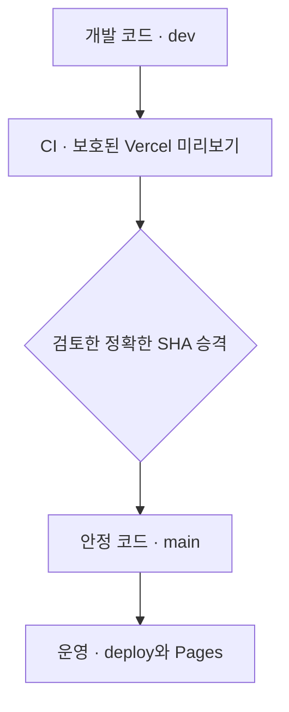
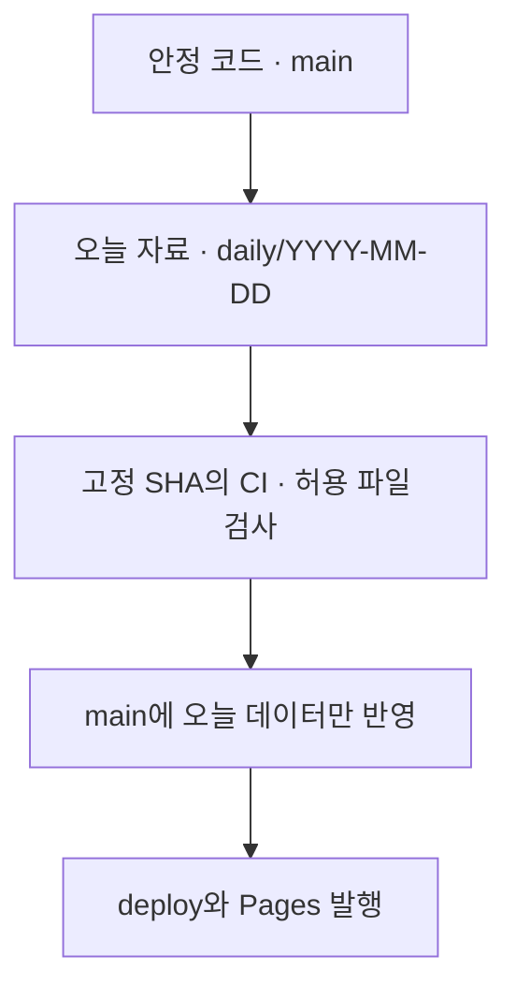

# 개발 미리보기와 운영 환경

**개발 화면은 보호된 Vercel에서 확인하고, 운영 사이트는 승인된 코드와 일일 데이터만 GitHub Pages로 공개합니다.** 개발 중인 코드가 다음 날 자동 발행에 섞이지 않도록 코드 승격과 일일 호 발행 경로를 나눕니다.

[문서 안내](../README.md) · [브랜치 절차](branches.md) · [자동화 이관](publish-automation.md) · [이번 환경 변경](changes-2026-11-04-preview.md)

## 환경과 브랜치의 역할

| 환경·브랜치 | 역할 | 공개·접근 기준 |
| --- | --- | --- |
| `dev` | 실험·개발 코드 | Vercel 개발 미리보기. 운영 자동 발행의 코드 원본으로 사용하지 않음 |
| `main` | 검토·검증한 안정 코드 | 코드 승격과 일일 데이터 반영의 기준 |
| `deploy` | GitHub Pages 공개 기준 | 승인된 `main`을 반영해 `korea-jogan.com`에 공개 |
| `daily/YYYY-MM-DD` | 해당 날짜의 조사·초안 | `main`에서 생성. 오늘 JSON·색인·실제 추적 갱신만 보관 |

`dev/web/`의 `dev`는 저장소 안의 디렉터리 이름입니다. `main`·`daily`에서도 같은 경로를 사용하며, 디렉터리 이름을 브랜치 역할과 혼동하지 않습니다.

## 코드 변경과 일일 발행은 다른 경로



코드 승격은 검토한 `dev`의 정확한 커밋 SHA를 대상으로 합니다. 수동 승격의 `admin_preview_verified`는 운영자가 해당 배포의 인증 경계와 관리자 미리보기를 확인했다는 명시적 입력입니다. Vercel 토큰 없이 실행하는 CI가 현재 실서비스 인증 정책까지 증명하는 것은 아닙니다. CI·해당 SHA의 Vercel 배포 성공·운영자의 보호/화면 확인·브랜치 관계를 확인한 뒤에만 `main`·`deploy`로 반영합니다. 첫 환경 구성의 실제 반영·검증 상태는 [변경 기록](changes-2026-11-04-preview.md)에서 확인합니다.



일일 경로는 `daily` 브랜치를 통째로 병합하지 않습니다. 안정된 `main`의 코드로 오늘 JSON·색인·실제 추적 변경만 가져옵니다. `dev`에 미완성 UI·스크립트가 있어도 아침 발행의 코드 원본이 바뀌지 않습니다.

## Vercel 개발 프로젝트

2026.11.04 설정 확인 기준입니다. 설정 등록과 실제 배포 성공은 별도입니다.

| 항목 | 확인된 내용 |
| --- | --- |
| 팀·플랜 | `minsangkwaks-projects` · Hobby |
| 프로젝트 | `korea-jogan-dev` |
| Git 연결 | `MinsangKwak/korea-jogan` |
| 개발 도메인 | `dev.korea-jogan.com`, Git 브랜치 `dev` 연결 |
| 배포 보호 | 모든 배포에 Vercel Authentication 적용 |
| 현재 팀 구성 | OWNER 1명 |
| 첫 실제 배포 | [`f4df437b`](https://vercel.com/minsangkwaks-projects/korea-jogan-dev/EQcoTBWNJtHv8bAjHEn6gwogBsEN) READY, 메타데이터·헤더·인증 경계 확인 |
| 기본 개발 주소 | [https://korea-jogan-dev-git-dev-minsangkwaks-projects.vercel.app](https://korea-jogan-dev-git-dev-minsangkwaks-projects.vercel.app) · Vercel 로그인 보호 |
| 개발 도메인 DNS | 현재 NXDOMAIN. 외부 DNS 설정 대기 |

인증된 연결로 첫 배포의 `preview-build.json`을 HTTP 200으로 읽어 `dev`·해당 SHA·2026-11-04호·17개 호와 검색 제외·비공개 캐시 헤더를 대조했습니다. 비로그인 첫 화면·색인 JSON·측정 스크립트·메타데이터는 모두 로그인으로 HTTP 302 이동했습니다.

Vercel 로그인과 이 프로젝트 접근 권한은 같은 뜻이 아닙니다. 현재 OWNER 1명이 확인됐으며 다른 검토자에게 보여 주려면 실제 팀·공유 권한을 별도로 확인합니다. 프로젝트를 만든 사실만으로 외부 검토자의 접근을 보장하지 않습니다.

## 개발 도메인 연결: 운영자가 할 일

도메인 DNS는 Gabia에서 관리됩니다. 아래 레코드를 추가한 뒤 Vercel의 도메인 확인과 실제 HTTPS 접근을 점검합니다.

| 설정 위치 | 종류 | 호스트 | 값 | TTL |
| --- | --- | --- | --- | --- |
| Gabia DNS | `CNAME` | `dev` | `cname.vercel-dns.com.` | 기본값 |

루트 `korea-jogan.com`의 기존 A 레코드는 유지합니다. DNS를 저장한 뒤에도 캐시·전파와 인증서 준비에 따라 접속 시점이 달라질 수 있습니다. 기본 Vercel 주소의 HTTPS·보호 경계는 확인했으며, `dev.korea-jogan.com`의 DNS·HTTPS 연결은 아직 완료되지 않았습니다.

## 미리보기에서 확인할 것

개발 전용 빌드는 운영 결과물과 다른 `dist-preview`에 생성합니다. `dev/web/`를 그대로 통째로 올리는 방식으로 공개 전 데이터를 노출하지 않습니다.

| 항목 | 개발 미리보기 기준 | 운영 기준 |
| --- | --- | --- |
| 접근 | Vercel Authentication | 일반 공개 |
| 검색 | HTML `noindex`와 응답 헤더, 크롤링 제한 | 공개 페이지의 검색 허용 규칙 |
| 방문 측정 | GA4 비활성화 | 운영자·자동화 제외 후 운영 GA4 측정 |
| 관리자 | 개발 환경·읽기 전용 안내 | 공개 발행 상태와 권한 있는 계정의 GA4 조회 |
| 발행 데이터 | 공개된 호만 포함 | 배포 검사에 통과한 공개 호 |
| 코드 | 실험·검토 대상 | 정확한 SHA로 승격한 안정본 |

`noindex`는 접근 권한을 대신하지 않습니다. 실제 비공개 경계는 배포 보호이며 HTML·헤더·robots는 검색 수집 방지의 추가 설정입니다. 미리보기는 새 코드의 화면·탐색·반응형·오류를 확인하는 환경이고, 오늘 초안은 `daily`의 데이터 검사와 별도 원문 대조로 확인합니다.

## 로컬에서 개발 결과물 확인

[개발 빌드](../../dev/pipeline/build/build_preview.py)와 [Vercel 설정](../../vercel.json)은 `dev`만 배포 대상으로 삼고 결과물을 분리합니다. 로컬 확인은 저장소 루트에서 실행합니다.

```bash
python3 dev/pipeline/build/build_preview.py
python3 -m http.server -d dist-preview 8001
```

로컬 서버는 Vercel Authentication을 재현하지 않습니다. 개발 배포의 `preview-build.json`에서 브랜치·소스 커밋·포함 호를 확인하고, 실제 인증 경계는 원격에서 별도로 확인합니다. 운영 배포의 `build-info.json`과 역할이 다릅니다.

## 완료 확인 순서

1. 개발 전용 빌드와 보호 설정을 검사합니다. 결과물에 초안 JSON·GA4 활성 설정이 없는지 확인합니다.
2. `dev`의 정확한 SHA로 Vercel 배포가 성공했는지 확인합니다. 다른 커밋의 성공을 가져다 쓰지 않습니다.
3. DNS 연결 뒤 개발 도메인의 HTTPS·인증 경계·실제 화면을 확인합니다.
4. CI·정확한 SHA의 Vercel 배포·운영자의 인증/관리자 확인·브랜치 조상 관계가 맞을 때만 [코드 승격](../../.github/workflows/promote.yml)을 실행합니다.
5. 정확한 SHA의 Pages 배포 성공과 공개 `build-info.json`의 실제 소스 SHA·호 날짜를 확인한 뒤 완료로 기록합니다. 배포 호출 응답만으로 완료 처리하지 않습니다. 개발 도메인의 성공을 운영 배포 성공으로 대신하지 않습니다.
