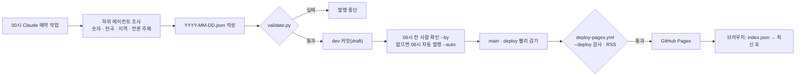

# 02 구조와 자동화

**서버와 빌드 도구 없이, 정적 HTML 한 장과 날짜별 JSON 한 개로 매일 신문을 발행합니다.** 품질은 사람이 아니라 검사 스크립트가 지키고, 검사를 통과한 커밋만 배포 전용 브랜치를 거쳐 나갑니다.

## 전체 흐름



## 구성 요소

| 구성 | 파일 | 하는 일 |
| --- | --- | --- |
| 화면 | [public/index.html](../../public/index.html) · [public/src/](../../public/src) | `index.html`은 마크업, `src/core`는 공통 코드, `src/components`는 섹션별 JS·CSS, `src/main.js`가 최신 호 JSON을 읽어 섹션을 차례로 그립니다 |
| 디자인 시스템 | [design/tokens.json](../../design/tokens.json) · [public/src/styles/](../../public/src/styles) | 토큰 원본과, 그것으로 만든 `tokens.css`, `kj-` 컴포넌트 `kj.css` |
| 토큰 CSS 생성 | [scripts/build/build_tokens.py](../../scripts/build/build_tokens.py) | `tokens.json`을 CSS 변수로 바꿉니다. CI가 `--check`로 어긋남을 막습니다 |
| 발행 데이터 | [public/data/issues/](../../public/data/issues) | `index.json`(최신 호·목록)과 날짜별 호. 형식은 [DATA.md](../guides/DATA.md) |
| 발행 전 검사 | [scripts/publish/validate.py](../../scripts/publish/validate.py) | 필수 항목, 출처·링크, 값 범위, 날짜, 시도 이름을 검사합니다 |
| 커밋 제목 검사 | [scripts/tools/check_commit_msg.mjs](../../scripts/tools/check_commit_msg.mjs) | 로컬 훅과 PR에서 `종류(범위): 제목` 규칙을 검사합니다 |
| 승인 | [scripts/publish/approve.py](../../scripts/publish/approve.py) | 초안을 `published`로 바꿉니다. `--by`는 확인한 사람·시각, `--auto`는 자동 발행 표시(`review.auto`)를 남깁니다 |
| 검색용 호별 페이지 | [scripts/build/build_pages.py](../../scripts/build/build_pages.py) · [indexnow.py](../../scripts/publish/indexnow.py) | 배포 때 호마다 `/YYYY-MM-DD` 페이지를 만들고 제목·설명·`NewsArticle` 구조화 데이터·본문 요약을 미리 넣습니다. 배포 직후 IndexNow로 새 주소를 알립니다 |
| RSS·사이트맵 | [scripts/build/build_feed.py](../../scripts/build/build_feed.py) | 승인된 호로 `feed.xml`·`sitemap.xml`을 만듭니다. 배포 때 실행 |
| 언론사 RSS 수집기 | [scripts/collect/fetch_rss.py](../../scripts/collect/fetch_rss.py) · [feeds.json](../../scripts/collect/feeds.json) | 26개 언론사 RSS에서 전날 기사의 제목·링크·날짜만 모읍니다. robots.txt를 지키고 본문은 받지 않습니다 |
| 공공 API 수집기 | [scripts/collect/fetch_ecos.py](../../scripts/collect/fetch_ecos.py) · [ecos_nums.py](../../scripts/collect/ecos_nums.py) | ECOS 원본(환율·기준금리·코스피·코스닥) 수집과 핵심 숫자 변환 |
| 워크플로 | [.github/workflows/](../../.github/workflows) | `check.yml` 검사, `deploy-pages.yml` 배포(평일 낮 매시 최신 공식 숫자 갱신 포함), `daily.yml` 수집 |
| 최신 공식 숫자 | [scripts/build/build_live.py](../../scripts/build/build_live.py) | ECOS 최신 일별 확정값으로 `live.json`을 만듭니다. 승인된 조간과 별개로 '자동 갱신 · 사람 확인 전'으로 표시합니다. 서버 없이 배포 워크플로가 매시 커밋 없이 다시 배포해 갱신합니다 |

## 화면 구현

빌드 없이 브라우저가 바로 읽는 정적 파일로 만들었습니다. 1인 운영에서 의존성 업데이트와 빌드 실패를 관리할 일을 없애기 위해서입니다. 화면은 `index.html`에 마크업을 두고, 스크립트와 스타일은 `src/components/<섹션>/`에 컴포넌트별로 나눴습니다. 번들러 없이 `defer` 스크립트를 공통(`core`) → 컴포넌트 → 진입점(`main.js`) 순서로 읽습니다. 색·글자·간격은 디자인 시스템 CSS 두 개(`src/styles/tokens.css`, `src/styles/kj.css`)에서 가져옵니다.

| 기능 | 구현 |
| --- | --- |
| 데이터 읽기 | `loadIssue`가 `index.json`의 `latest`를 읽고 그 호를 `fetch`합니다. 페이지 안에 `<script type="application/json" id="issue-data">`가 있으면 그것을 먼저 써서, 미리보기 환경에서도 같은 파일로 그릴 수 있습니다 |
| 섹션 이동 | 1200px 이상 오른쪽 세로 메뉴, 861~1199px 상단 분류 메뉴, 860px 이하 하단 탭바, 오른쪽 전체 메뉴 서랍이 모두 같은 `SECTIONS` 목록에서 만들어집니다. 세로 메뉴가 가운데 단에 닿는 1200~1499px에서는 그 폭만큼 오른쪽을 비웁니다. 분류 메뉴는 `<header>` 밖에 두어 sticky가 본문 끝까지 유지됩니다. 스크롤 위치로 지금 읽는 섹션을 찾아 세 곳 모두에 `aria-current`를 붙입니다. 서랍은 `role="dialog"`·`aria-modal`이고, Esc·가림막으로 닫히며 열린 동안 포커스를 안에 가두고 닫으면 연 단추로 돌려줍니다 |
| 지역 선택 | `REGION_GROUPS`로 17개 시도를 여섯 권역에 묶어 단추로 그리고, 누르면 그 시도 기사로 바꿉니다. 900px 이하에서는 한 줄 가로 스크롤로 바꿔 기사 목록이 화면 위쪽에 오게 했습니다 |
| 목록 접기 | `collapse(list, opts)` 하나로 3개를 넘는 목록을 접고 '더보기 (N건)' 단추를 붙입니다. 분야를 바꾸거나 홈 카드에서 특정 항목으로 건너뛰면 `expandFor`가 필요한 만큼 펼칩니다 |
| 주제 검색 | 입력을 낱말로 나누고 불용어를 뺀 뒤 주제의 `keywords`·제목과 겹치는 수로 점수를 매깁니다. 서버 없이 그날 호 안에서 찾습니다 |
| 국가채무 그래프 | 최댓값 대비 비율로 막대 폭을 정하고, 전망치는 다른 모양으로, 빠진 연도는 '미확인' 줄로 표시합니다. 전년 대비 증가액을 함께 적습니다 |
| D-Day | 대통령 임기 경과율과 선거·예산 처리기한 남은 날을 발행일 기준으로 계산합니다 |
| 글자 크기 | 루트 글자 크기 변수 하나만 바꿔 전체를 키웁니다. 선택은 `localStorage`에 두고, 저장이 막힌 환경에서도 화면은 그대로 동작합니다 |
| 디자인 시스템 | 색 27개·글자 16단계·간격·모서리·선·크기를 `design/tokens.json` 한 곳에 두고 `build_tokens.py`로 CSS 변수를 만듭니다. 컴포넌트(숫자 카드, 출처 펼치기, 신뢰도 배지, 막대 그래프 등)는 `kj-` 클래스로 씁니다 |
| 테마·접근성 | 본문 4.5:1, 막대·테두리 3:1 이상을 두 테마 모두에서 지킵니다. `prefers-color-scheme`으로 어두운 화면, 누르는 요소는 모두 44px 이상, 가장 작은 글자는 0.8rem입니다. 신뢰도·결산/전망·법정일/계산일은 색이 아니라 모양(채움·실선·점선)과 글자로 구분합니다. `prefers-reduced-motion`이면 부드러운 스크롤과 뼈대 깜빡임을 끕니다 |
| 상태 | 불러오는 중에는 뼈대, 실패하면 '다시 불러오기' 오류 상자, 검색 결과가 없으면 대신 볼 주제를 보여 줍니다 |

스크립트는 `'use strict'`로 실행하고, 화면 문자열은 `textContent`로 넣어 데이터 안의 HTML이 실행되지 않게 했습니다.

## 검사 규칙

`validate.py`는 `index.json`에 있는 모든 호를 검사하고, 하나라도 실패하면 종료 코드 1을 돌려줍니다.

| 대상 | 규칙 |
| --- | --- |
| 공통 | 필수 항목 13개(`date`, `lead`, `briefs`, `nums`, `themes`, `items`, `industries`, `trade`, `debt`, `fiscal`, `nps`, `agenda`, `limits`), 파일 이름과 `date` 일치 |
| 핵심 숫자 | 출처 기관 이름과 `https` 원문 링크, 방향은 `up`·`down`·`flat`만 |
| 언론 주제 | AI 요약·기사·키워드가 모두 있고, 기사마다 `https` 링크 |
| 수출입 품목 | 금액이 0보다 큰 숫자 |
| 국가채무 | 연도 오름차순, 금액 100~5,000조, GDP 대비 10~150% |
| 전국·지역 뉴스 | 기사마다 `https` 링크와 요약, 지역은 17개 시도 이름만 |

## 브랜치와 배포

```text
main ──(맞춤)──▶ dev ──(PR 병합)──▶ main ──(그대로 올림)──▶ deploy ──▶ GitHub Pages
```

| 결정 | 이유 |
| --- | --- |
| 배포 전용 `deploy` 브랜치 | 개발·최종본 push가 곧바로 배포로 이어지지 않게, 배포 시점을 브랜치 하나로 통제하기 위해 |
| `deploy`에서 한 번 더 검사 | 로컬이나 예약 작업이 검사를 건너뛰어도 틀린 데이터가 배포되지 않게 하기 위해 |
| 빨리 감기만 허용 | 자동 발행이 다른 사람의 변경을 덮어쓰지 않게. 빨리 감기가 안 되면 멈추고 보고합니다 |
| `github-pages` 환경의 배포 브랜치 제한 | 허용 목록에 `main`·`deploy`만 두어 다른 브랜치에서 배포할 수 없게 |

자세한 순서는 [BRANCHES.md](../guides/BRANCHES.md)에 있습니다.

## 자동 발행

| 항목 | 내용 |
| --- | --- |
| 실행 | Claude 예약 작업, 매일 00시(한국 시간) |
| 저장소 접근 | 저장소가 연결된 전용 세션에 예약 작업을 묶어, 매일 같은 작업 지침과 도구로 실행합니다 |
| 조사 | 분야별 하위 에이전트를 동시에 돌립니다(핵심 숫자 · 전국 · 지역 두 묶음 · 언론 주제) |
| 상설 지표 | 재정·국민연금·수출입은 새 공식 발표가 있을 때만 바꾸고, 없으면 지난 호 값을 씁니다 |
| 실패 처리 | 고칠 수 없는 섹션은 지난 호 값으로 되돌린 뒤 다시 검사하고, 그래도 실패하면 발행하지 않습니다 |
| 사람 확인 | 06시 전에 사람이 머리기사·핵심 숫자·갈린 숫자를 대조하면 '편집자 확인' 호로, 아니면 검사를 통과한 초안을 '자동 발행' 호로 06시에 냅니다. 독자는 제호 옆 표시로 둘을 구분합니다 |

절차 전체는 [DAILY_RUNBOOK.md](../guides/DAILY_RUNBOOK.md)에 있습니다.

## 기술 선택

| 선택 | 이유 | 대가 |
| --- | --- | --- |
| 정적 사이트 + GitHub Pages | 서버·DB 비용이 없고 1인 운영에서 장애 지점이 적음 | 검색·아카이브 같은 기능을 브라우저 안에서 해결해야 함 |
| 프레임워크·번들러 없는 정적 파일 | 빌드·의존성 관리가 없음. 정적 서버 하나로 그대로 띄울 수 있음 | 모듈 시스템 대신 스크립트 읽는 순서에 기대므로, 새 컴포넌트는 `index.html`의 스크립트 목록에 `main.js`보다 앞에 넣어야 함 |
| JSON 한 호 = 파일 하나 | 하루 단위로 diff·되돌리기가 쉽고, 검사를 파일 단위로 돌릴 수 있음 | 호가 쌓이면 아카이브 색인이 따로 필요 |
| 검사는 Python 표준 라이브러리만 | CI에서 설치 없이 바로 실행 | 스키마 검증 도구보다 규칙을 직접 써야 함 |
| AI 에이전트 조사 + 사람이 정한 규칙 | 공공 API로 못 얻는 기사·지역 소식을 매일 모을 수 있음 | 숫자를 지어낼 위험이 있어 출처 필수 검사와 '미확인' 표기로 막음 |

## 앞으로 바꿀 부분

- 핵심 숫자는 공공 API(ECOS·KOSIS·관세청) 수집기로 옮겨, 에이전트 조사는 기사·요약에만 쓰게 합니다. ECOS는 '최신 공식 숫자' 띠에서 먼저 쓰고 있습니다.
- 지난 호는 호별 페이지(`/YYYY-MM-DD`)로 엽니다. 호가 수백 개로 늘면 목록을 달·연 단위로 나눕니다.
