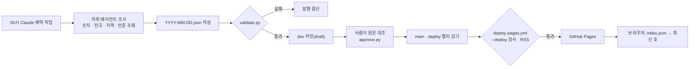

# 02 구조와 자동화

**서버와 빌드 도구 없이, 정적 HTML 한 장과 날짜별 JSON 한 개로 매일 신문을 발행합니다.** 품질은 사람이 아니라 검사 스크립트가 지키고, 검사를 통과한 커밋만 배포 전용 브랜치를 거쳐 나갑니다.

## 전체 흐름



## 구성 요소

| 구성 | 파일 | 하는 일 |
| --- | --- | --- |
| 화면 | [public/index.html](../../public/index.html) | 배치 CSS·마크업·JS. 최신 호 JSON을 읽어 섹션별로 그립니다 |
| 디자인 시스템 | [design/tokens.json](../../design/tokens.json) · [public/assets/](../../public/assets) | 토큰 원본과, 그것으로 만든 `tokens.css`, `kj-` 컴포넌트 `kj.css` |
| 토큰 CSS 생성 | [scripts/build_tokens.py](../../scripts/build_tokens.py) | `tokens.json`을 CSS 변수로 바꿉니다. CI가 `--check`로 어긋남을 막습니다 |
| 발행 데이터 | [public/data/issues/](../../public/data/issues) | `index.json`(최신 호·목록)과 날짜별 호. 형식은 [DATA.md](../DATA.md) |
| 발행 전 검사 | [scripts/validate.py](../../scripts/validate.py) | 필수 항목, 출처·링크, 값 범위, 날짜, 시도 이름을 검사합니다 |
| 커밋 제목 검사 | [scripts/check_commit_msg.mjs](../../scripts/check_commit_msg.mjs) | 로컬 훅과 PR에서 `종류(범위): 제목` 규칙을 검사합니다 |
| 승인 | [scripts/approve.py](../../scripts/approve.py) | 사람이 확인한 초안을 `published`로 바꾸고 확인한 사람·시각을 남깁니다 |
| RSS | [scripts/build_feed.py](../../scripts/build_feed.py) | 승인된 호로 `feed.xml`을 만듭니다. 배포 때 실행 |
| 공공 API 수집기 | [scripts/fetch_ecos.py](../../scripts/fetch_ecos.py) · [ecos_nums.py](../../scripts/ecos_nums.py) | ECOS 원본(환율·기준금리·코스피·코스닥) 수집과 핵심 숫자 변환 |
| 워크플로 | [.github/workflows/](../../.github/workflows) | `check.yml` 검사, `deploy-pages.yml` 배포, `daily.yml` 수집 |

## 화면 구현

빌드 없이 브라우저가 바로 읽는 정적 파일로 만들었습니다. 1인 운영에서 의존성 업데이트와 빌드 실패를 관리할 일을 없애기 위해서입니다. 화면은 `index.html` 하나에 배치·마크업·JS를 두고, 색·글자·간격은 디자인 시스템 CSS 두 개(`assets/tokens.css`, `assets/kj.css`)에서 가져옵니다.

| 기능 | 구현 |
| --- | --- |
| 데이터 읽기 | `loadIssue`가 `index.json`의 `latest`를 읽고 그 호를 `fetch`합니다. 페이지 안에 `<script type="application/json" id="issue-data">`가 있으면 그것을 먼저 써서, 미리보기 환경에서도 같은 파일로 그릴 수 있습니다 |
| 섹션 이동 | 상단 분류 메뉴와 860px 이하 하단 메뉴가 같은 `SECTIONS` 목록에서 만들어집니다. 스크롤 위치로 지금 읽는 섹션을 찾아 `aria-current`를 붙입니다 |
| 지역 지도 | 17개 시도를 실제 위치에 가깝게 4열 격자 타일로 배치하고, 누르면 그 시도 기사로 바꿉니다 |
| 주제 검색 | 입력을 낱말로 나누고 불용어를 뺀 뒤 주제의 `keywords`·제목과 겹치는 수로 점수를 매깁니다. 서버 없이 그날 호 안에서 찾습니다 |
| 국가채무 그래프 | 최댓값 대비 비율로 막대 폭을 정하고, 전망치는 다른 모양으로, 빠진 연도는 '미확인' 줄로 표시합니다. 전년 대비 증가액을 함께 적습니다 |
| D-Day | 대통령 임기 경과율과 선거·예산 처리기한 남은 날을 발행일 기준으로 계산합니다 |
| 글자 크기 | 루트 글자 크기 변수 하나만 바꿔 전체를 키웁니다. 선택은 `localStorage`에 두고, 저장이 막힌 환경에서도 화면은 그대로 동작합니다 |
| 디자인 시스템 | 색 27개·글자 16단계·간격·모서리·선·크기를 `design/tokens.json` 한 곳에 두고 `build_tokens.py`로 CSS 변수를 만듭니다. 컴포넌트(숫자 카드, 출처 펼치기, 신뢰도 배지, 막대 그래프 등)는 `kj-` 클래스로 씁니다 |
| 테마·접근성 | 본문 4.5:1, 막대·테두리 3:1 이상을 두 테마 모두에서 지킵니다. `prefers-color-scheme`으로 어두운 화면, 누르는 요소는 모두 44px 이상, 가장 작은 글자는 0.8rem입니다. 신뢰도·결산/전망·법정일/계산일은 색이 아니라 모양(채움·실선·점선)과 글자로 구분합니다. `prefers-reduced-motion`이면 부드러운 스크롤과 뼈대 깜빡임을 끕니다 |
| 상태 | 불러오는 중에는 뼈대, 실패하면 '다시 불러오기' 오류 상자, 검색 결과가 없으면 대신 볼 주제를 보여 줍니다 |

스크립트는 `'use strict'`로 실행하고, 화면 문자열은 `textContent`로 넣어 데이터 안의 HTML이 실행되지 않게 했습니다.

## 검사 규칙

`validate.py`는 `index.json`에 있는 모든 호를 검사하고, 하나라도 실패하면 종료 코드 1을 돌려줍니다.

| 대상 | 규칙 |
| --- | --- |
| 공통 | 필수 항목 13개(`date`, `lead`, `briefs`, `nums`, `themes`, `items`, `industries`, `trade`, `debt`, `fiscal`, `nps`, `agenda`, `limits`), 파일 이름과 `date` 일치 |
| 핵심 숫자 | 출처 기관 이름과 `https` 원문 링크, 방향은 `up`·`down`·`flat`만 |
| 언론 주제 | AI 요약·기사·키워드가 모두 있고, 기사마다 `https` 링크 |
| 수출입 품목 | 금액이 0보다 큰 숫자 |
| 국가채무 | 연도 오름차순, 금액 100~5,000조, GDP 대비 10~150% |
| 전국·지역 뉴스 | 기사마다 `https` 링크와 요약, 지역은 17개 시도 이름만 |

## 브랜치와 배포

```text
main ──(맞춤)──▶ dev ──(PR 병합)──▶ main ──(그대로 올림)──▶ deploy ──▶ GitHub Pages
```

| 결정 | 이유 |
| --- | --- |
| 배포 전용 `deploy` 브랜치 | 개발·최종본 push가 곧바로 배포로 이어지지 않게, 배포 시점을 브랜치 하나로 통제하기 위해 |
| `deploy`에서 한 번 더 검사 | 로컬이나 예약 작업이 검사를 건너뛰어도 틀린 데이터가 배포되지 않게 하기 위해 |
| 빨리 감기만 허용 | 자동 발행이 다른 사람의 변경을 덮어쓰지 않게. 빨리 감기가 안 되면 멈추고 보고합니다 |
| `github-pages` 환경의 배포 브랜치 제한 | 허용 목록에 `main`·`deploy`만 두어 다른 브랜치에서 배포할 수 없게 |

자세한 순서는 [BRANCHES.md](../BRANCHES.md)에 있습니다.

## 자동 발행

| 항목 | 내용 |
| --- | --- |
| 실행 | Claude 예약 작업, 매일 00시(한국 시간) |
| 저장소 접근 | 비공개 저장소라 새 세션을 매번 띄우는 방식으로는 접근할 수 없어, 저장소가 연결된 전용 세션에 예약 작업을 묶었습니다 |
| 조사 | 분야별 하위 에이전트를 동시에 돌립니다(핵심 숫자 · 전국 · 지역 두 묶음 · 언론 주제) |
| 상설 지표 | 재정·국민연금·수출입은 새 공식 발표가 있을 때만 바꾸고, 없으면 지난 호 값을 씁니다 |
| 실패 처리 | 고칠 수 없는 섹션은 지난 호 값으로 되돌린 뒤 다시 검사하고, 그래도 실패하면 발행하지 않습니다 |
| 사람 확인 | 자동 작업은 `draft`까지만 씁니다. 머리기사·핵심 숫자·갈린 숫자를 사람이 원문과 대조해 승인해야 배포됩니다 |

절차 전체는 [DAILY_RUNBOOK.md](../DAILY_RUNBOOK.md)에 있습니다.

## 기술 선택

| 선택 | 이유 | 대가 |
| --- | --- | --- |
| 정적 사이트 + GitHub Pages | 서버·DB 비용이 없고 1인 운영에서 장애 지점이 적음 | 검색·아카이브 같은 기능을 브라우저 안에서 해결해야 함 |
| 프레임워크 없는 단일 HTML | 빌드·의존성 관리가 없음. 미리보기 환경에 파일 하나로 그대로 띄울 수 있음 | 파일이 길어짐(약 1,100줄). 함수 단위로 나눠 관리 |
| JSON 한 호 = 파일 하나 | 하루 단위로 diff·되돌리기가 쉽고, 검사를 파일 단위로 돌릴 수 있음 | 호가 쌓이면 아카이브 색인이 따로 필요 |
| 검사는 Python 표준 라이브러리만 | CI에서 설치 없이 바로 실행 | 스키마 검증 도구보다 규칙을 직접 써야 함 |
| AI 에이전트 조사 + 사람이 정한 규칙 | 공공 API로 못 얻는 기사·지역 소식을 매일 모을 수 있음 | 숫자를 지어낼 위험이 있어 출처 필수 검사와 '미확인' 표기로 막음 |

## 앞으로 바꿀 부분

- 핵심 숫자는 공공 API(ECOS·KOSIS·관세청) 수집기로 옮겨, 에이전트 조사는 기사·요약에만 쓰게 합니다.
- 지난 호 아카이브는 `?d=YYYY-MM-DD`로 같은 화면에서 엽니다. 호가 수백 개로 늘면 목록을 달·연 단위로 나눕니다.
