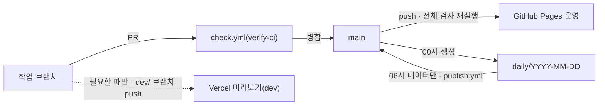

# 브랜치·환경·배포

**장기 브랜치는 `main` 하나입니다. 기능은 작업 브랜치 → `main` 대상 PR(`verify-ci`) → `main` 병합 시 GitHub Pages 운영 배포 순서로 나갑니다. Vercel 미리보기(dev)는 기본 절차가 아니며, 병합 전에 화면을 직접 봐야 할 때만 붙입니다.** 일일 자료는 `main` 기반 `daily/YYYY-MM-DD`에서 데이터만 선별 반영합니다. 2026.11.21 `dev`·`deploy` 브랜치를 정리하면서 'dev'를 PR 미리보기 환경으로 바꿨고, 2026.11.25 거의 모든 작업이 곧바로 `main`에 들어가는 점을 반영해 PR마다 만들던 미리보기를 선택 실행으로 바꿨습니다. 일일 발행 절차 자체는 [런북](../planning/runbook.md), 커밋 형식은 [커밋 기준](commits.md)에 있습니다.

[문서 안내](../README.md) · [공통 작업 지침](../AGENTS.md) · [기술 구조](architecture.md) · [변경 기록](changelog.md)

## 브랜치와 환경

| 브랜치 | 역할 | 반영 경로 | 공개·접근 |
| --- | --- | --- | --- |
| `feature/<기능명>` 등 작업 브랜치 | 기능 하나의 구현·검증 | 목적별 커밋, 기능 하나의 PR로 `main`에 제안 | 미리보기 없음 |
| `dev/<이름>` | 병합 전 화면 확인이 필요한 작업 | 작업 브랜치와 같은 방식의 PR, 또는 확인만 하고 버리는 임시 브랜치 | push마다 Vercel `korea-jogan-dev` 미리보기, Vercel Authentication |
| `main` | 운영 코드 + 공개 데이터 | 검사를 통과한 PR 병합, 일일 데이터의 제한된 반영 | push마다 [korea-jogan.com](https://korea-jogan.com/) 배포 |
| `daily/YYYY-MM-DD` | 그날의 조사·초안·색인·실제 추적 갱신 | `main`에서 생성, 허용 데이터만 가져오기 | 미리보기 없음 |

`frontend-vanilla-js/`는 브랜치가 아닌 디렉터리이며 모든 브랜치에서 같은 경로를 사용합니다. 미완성·배포 보류 기능은 작업 브랜치에 남기고 PR을 병합하지 않습니다. `main`에 병합하는 순간 운영에 나가므로 PR의 `verify-ci`가 마지막 확인 단계입니다. 자동 검사로 판단하기 어려운 화면 변경은 병합 전에 미리보기를 붙여 확인합니다. 공개된 이력을 다시 쓰거나 강제 push하지 않습니다.

## 기능 반영 순서

1. 최신 `main`에서 작업 브랜치를 만들고 목적·폴더·역할별 커밋을 나눕니다. PR은 기능 하나로 묶습니다.
2. `main` 대상 PR을 엽니다. `check.yml`이 [공통 검사 작업](../../../.github/actions/verify/action.yml)(`verify-ci`)을 돌립니다. Vercel 미리보기는 만들어지지 않습니다.
3. `verify-ci`가 성공이면 병합합니다. 화면을 미리 봐야 하면 [필요할 때 미리보기 붙이기](#필요할-때-미리보기-붙이기)를 먼저 거칩니다.
4. `main` push로 `deploy-pages.yml`이 시작되어 병합 커밋의 전체 검사를 통과한 경우에만 Pages에 배포하고 공개 `build-info.json`의 `sourceSha`·날짜를 대조합니다.
5. Pages 성공과 공개 `build-info.json`을 확인한 뒤 완료로 기록합니다. 병합만으로 완료라고 하지 않습니다.

병합 전 검사를 필수로 만들려면 GitHub 저장소 설정의 `main` 보호 규칙(Require status checks)에 `verify-ci`를 지정합니다. `Vercel` 상태는 대부분의 PR에 생기지 않으므로 필수로 지정하지 않습니다. 이 규칙은 저장소 설정이라 이 문서의 변경으로 켜지지 않습니다.

### 필요할 때 미리보기 붙이기

레이아웃·글꼴처럼 실제 화면을 봐야 판단할 수 있는 변경에만 씁니다.

- **처음부터 확인이 필요한 작업** — 작업 브랜치 이름을 `dev/<이름>`으로 짓습니다. push마다 미리보기가 갱신됩니다.
- **작업 도중 확인이 필요해진 경우** — 같은 커밋을 `git push origin HEAD:refs/heads/dev/<이름>`으로 한 번 더 올립니다. 확인이 끝나면 `dev/<이름>` 브랜치를 지웁니다.
- **브랜치 이름을 바꿀 수 없는 경우** — Vercel `korea-jogan-dev` 프로젝트에서 해당 브랜치를 수동 배포(Create Deployment)합니다. 자동 배포만 꺼 두었으므로 수동 배포는 그대로 동작합니다.

주소는 `korea-jogan-dev-git-<브랜치>-minsangkwaks-projects.vercel.app`(브랜치의 `/`는 `-`)이며 화면 상단 띠에 브랜치·SHA가 표시됩니다. 미리보기는 확인 수단이고 병합 조건은 `verify-ci`입니다.

## 워크플로와 실행 환경

| 파일 | 트리거 | 책임 |
| --- | --- | --- |
| [check.yml](../../../.github/workflows/check.yml) | `main` 대상 PR, `daily/**` push | 쓰기 권한 없이 [공통 검사 작업](../../../.github/actions/verify/action.yml) 실행 = `verify-ci` |
| Vercel Git 연동 | `dev/**` 브랜치 push(그 밖의 브랜치는 자동 배포 끔) | [build_preview.py](../../../backend-python/pipeline/build/build_preview.py)로 보호된 미리보기 빌드 |
| [deploy-pages.yml](../../../.github/workflows/deploy-pages.yml) | `main` push, 수동(고정 SHA), 평일 KST 09:17~22:17 매시 | 배포 SHA 고정 → 같은 SHA의 전체 검사 성공 증거가 없으면 전체 검사 → `validate --deploy` → RSS·사이트맵·호별 HTML·`live.json`·`build-info.json` 생성 → Pages → 공개 확인. 실패 시 같은 소스로 최대 두 번 재시도 |
| [publish.yml](../../../.github/workflows/publish.yml) | KST 06:00·06:07·06:37·07:17·08:17 (`main` 참조) | 오늘 `daily` SHA의 CI 확인 → 허용 데이터만 준비 → 자동 승인 → `main` 반영 → Pages 호출 → 공개 `build-info.json` 오늘 호·SHA 대조 |
| [daily.yml](../../../.github/workflows/daily.yml) | 매일 04:30 KST·수동 | RSS 원자료·이슈 추적 편집 후보. ECOS는 수동 실행 시 수집 |

공통 검사 작업은 데이터 검사·토큰 CSS 일치·Python 시험·PR 커밋 제목·브라우저 검사를 한 실행 환경에서 수행합니다. 검사를 삭제하거나 경로 필터로 건너뛰지 않습니다.

`GITHUB_TOKEN` push는 후속 Actions를 자동 시작하지 않으므로 일일 발행은 `main` 반영 뒤 같은 SHA로 `deploy-pages.yml`을 명시적으로 호출합니다([auto_release.py](../../../backend-python/pipeline/publish/auto_release.py)). `deploy-pages.yml`은 이벤트 종류와 상관없이 배포할 `main` SHA에 성공한 `verify`·`verify-ci`가 없으면 그 SHA를 다시 전체 검사한 뒤에만 배포합니다. 그래서 병합 push의 검사가 실패한 코드가 다음 매시 예약이나 수동 실행으로 공개되지 않고, 일일 발행 커밋도 배포 전에 한 번 검사합니다(약 3분 추가). 시간당 배포는 SHA가 같아도 `builtAt`이 이번 결과와 같아야 공개 완료로 봅니다([verify_publication.py](../../../backend-python/pipeline/publish/verify_publication.py)).

2026.11.21 이전의 `dev` 통합 → `integration.yml`·`promote.yml`의 태그·`main`·`deploy` 자동 승격 경로는 브랜치 정리와 함께 없앴습니다. 기존 `release-*` 태그는 당시 기록으로 남깁니다.

## 개발 미리보기 (Vercel)

접근·DNS는 2026.11.04 확인 기록이며 배포 대상은 2026.11.21과 2026.11.25에 변경했습니다. 설정 등록·실제 배포·DNS 연결·사용자 네트워크 접속은 서로 다른 확인 항목입니다.

| 항목 | 값 |
| --- | --- |
| 팀·프로젝트 | `minsangkwaks-projects`(Hobby) · `korea-jogan-dev` · Git `MinsangKwak/korea-jogan` · OWNER 1명 |
| 프로젝트 루트 | `project/tools/vercel-preview/`. 루트 밖의 소스 파일을 빌드에 포함해 프런트엔드와 Python 빌더를 읽습니다. |
| 배포 대상 | `dev/**` 브랜치 push와 수동 배포. `main`·`daily/*`는 빌더가 거부합니다. 프로젝트 루트 기준 `dist-preview/`에 출력합니다. [미리보기 설정](../../tools/vercel-preview/vercel.json) · [빌더](../../../backend-python/pipeline/build/build_preview.py) |
| 보호 | 모든 배포에 Vercel Authentication. 로그인과 프로젝트 접근 권한은 별개 |
| 주소 | 브랜치별 `korea-jogan-dev-git-<브랜치>-minsangkwaks-projects.vercel.app`(빌드 시 `VERCEL_BRANCH_URL`을 원점으로 사용) · `dev.korea-jogan.com`은 Vercel에서 연결한 배포만 가리킴 |
| DNS | Gabia `CNAME dev → 7e4c24757c5a10ba.vercel-dns-017.com.`(TTL 600). 루트 A 레코드 유지, `cname.vercel-dns.com.` 중복 추가 금지. Vercel HTTPS 확인 이력 있음, 사용자 PC NXDOMAIN은 별도 확인 |

| 항목 | 개발 미리보기 | 운영 |
| --- | --- | --- |
| 접근 | Vercel Authentication | 공개 |
| 검색 | HTML `noindex` + 응답 헤더(`X-Robots-Tag`, `no-store`) | 공개 페이지 검색 허용 |
| 측정 | GA4 비활성 | 운영자·자동화 제외 후 GA4 |
| 관리자 | 개발·읽기 전용 안내 | 발행 현황 + 권한 있는 계정의 GA4·검색 조회 |
| 데이터 | 공개 호만(`preview-build.json`에 브랜치·SHA·포함 호 기록) | 배포 검사 통과 공개 호(`build-info.json`) |

`noindex`는 접근 권한이 아닙니다. 로컬 확인은 `python3 backend-python/pipeline/build/build_preview.py && python3 -m http.server -d project/tools/vercel-preview/dist-preview 8001`이며 인증은 재현되지 않습니다.

## 일일 발행 경로의 보호 조건

[prepare_daily.py](../../../backend-python/pipeline/publish/prepare_daily.py)가 안정 `main` 작업본에서 고정 소스 SHA의 오늘 JSON·색인·추적 자료만 가져옵니다. 다음이면 중단합니다.

- 변경 파일이 오늘 호·`index.json`·`trackers.json` 밖에 있음(코드·과거 호·검사 스크립트 혼입)
- 색인이 `main`의 기존 날짜를 보존하지 않거나 `latest`가 오늘이 아님
- 조사 시작 뒤 `main`의 오늘 호·추적 자료가 바뀜(동시 변경)
- 추적 자료가 `updated`만 바꿨거나 `updated`가 발행일과 다름
- 같은 날짜가 이미 `published`로 공개됨(중복 발행 안 함)

`publish.yml`은 확인 중 `main`·`daily`가 바뀌었거나 둘이 조상 관계가 아니면 push하지 않습니다. 일일 브랜치의 소스 코드는 실행하지 않습니다.

## 실패와 복구

| 증상 | 먼저 확인할 내용 |
| --- | --- |
| 미리보기가 안 생김 | 브랜치 이름이 `dev/`로 시작하는지, 그 브랜치의 [미리보기 설정](../../tools/vercel-preview/vercel.json)이 최신 `main`을 반영했는지 |
| 미리보기가 Error | Vercel 빌드 로그. `main`·`daily/*`·SHA 없는 빌드는 [build_preview.py](../../../backend-python/pipeline/build/build_preview.py)가 의도적으로 거부 |
| 병합했는데 배포 안 됨 | `deploy-pages.yml`의 `verify` 작업 실패 여부 → `deploy` 작업 |
| 개발 주소가 안 열림 | Gabia DNS·Vercel 도메인 확인·배포 보호 권한 |
| 브랜치 반영 뒤 화면이 그대로임 | Pages 실행·배포 대상 SHA·공개 색인·`build-info.json` |
| 배포 소스 불일치로 중단 | 실행 중 `main`이 바뀜. 최신 `main`으로 다시 실행 |
| 오늘 호가 없거나 공개 안 됨 | [런북의 장애 추적 순서](../planning/runbook.md#장애-추적-순서) |

강제 push·일일 브랜치 전체 병합·빈 커밋으로 검사를 우회하지 않습니다.

일일 누락 복구는 안정 `publish.yml`의 `publish_pending.py`가 최근 7일에 실제 존재하는 일일 원본만 선별합니다. 기존 과거 호는 덮어쓰지 않으며 최신 날짜·운영 코드·더 최근 추적 기록을 보존합니다. 오늘 원본이 없으면 확인 범위를 밝힌 RSS 보조 초안을 생성하고 같은 원본 SHA의 전체 검사를 거쳐 발행합니다. 상세는 [런북](../planning/runbook.md#자동-발행-누락-복구--20261112)을 따릅니다.
